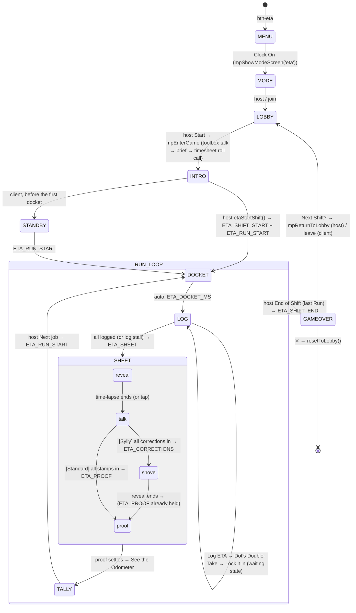

# New Game Technical Spec — ETA?
**Document type:** Phase 2 — Technical Specification
**Who filled this in:** Claude Code (Opus), 10 Nov 2026, from `docs/new-game-brief-eta.md` (v4) + the picked board
**Status:** **CONFIRMED by the owner 10 Nov 2026** — every §16 default accepted (fonts self-hosted ≤120 KB · `#EA580C` kept · scale re-fit at Proof · engine roll-call hooks · provisional content · 60 s log stall · Practice this pass · "Shift" kept). §17 deviations accepted.

**Sources read:** the brief (whole, incl. §0, §0d, Stage 2 appendix + build plan) · boards
`docs/new-ideas/eta/for archive/boards/depot-directions/Main.dc.html` (picked) + `Intro.dc.html` ·
`boards/reveal-mockups-round1/Backseat.dc.html` (Sylly mechanics only) · `eta-maths-round-1.md` +
`eta_sim.py` (`credit_pts`, `sylly_run`) · `eta-handoff-content-and-board.md` §4 ·
`docs/rules/new-game-process.md`, `new-game-checklist.md`, `ui-revamp.md` §§1–7, `docs/ui-revamp-lessons.md`
L1–L9 · the three always-loaded rule files · `js/engine-intro.js`, `MP_GAME_CONFIGS` (li5, cjar, cld,
comb), `cld.js` (client→host private commit), `cost-envelope.md` (fonts).

**Precedence (brief L8):** the brief wins on rules; the boards win on look and motion; this spec wins
over both once confirmed.

---

## Consistency Audit

| Check | Finding |
|-------|---------|
| Terminology collisions (every `docs/game-identities/*.md`) | **No hard collisions.** 48 terms grepped. Soft overlaps only: **"Shift"** — JEC's play-again is *New Shift?* (`jec-new-shift-overlay`); ETA's match is a *Shift* and its play-again *Next Shift?*. The brief §0a already scopes this (JEC = kitchen shift; ETA = courier shift, its round words are courier words). Kept — flagged §16 Q8. **"Briefing"** — DSD *Strategic Briefing* (a screen), SS *Operations Briefing* (settings title), LTTP *Briefing* (a heading). ETA always says **Dispatch Briefing** (a docket field) — distinct compound, kept. **"Stamp"** — PKO *Stampede* only (different word). **"Sweep"** — SS *Intel Sweep* (different compound). **"Logged"** — GM/GTH prose only. Retired terms (brief §9) appear nowhere in the plan. |
| `pill-active-[colour]` | **`pill-active-eta` does not exist** — added (custom class, like `pill-active-pko`). Also new: `game-toggle-on-eta`, `eta-range`, `eta-cta`, `eta-label`. |
| Abbreviation `eta` | **Free.** Not in `definitions.md` § Active plugin prefixes (games + lobby modules + arcade cabinets `ap ms ck sl hj sto bb`); no `eta[A-Z]` symbol anywhere in `js/`, `tools/`, `css/`, `src/`. Added to the prefix list in the same pass. |
| Screen IDs | **No `screen-eta-*` exists.** |
| Brand colour | Hi-vis orange `#EA580C` (hue ≈ 21°). Audit done in the brief §11 (clear of YGI amber, COMB honey, PKO rust by lightness, LTTP red). `GAME_BRAND_HEX` gains `'btn-eta': '#EA580C'`. |
| Data file | **New file `data/eta-data.json`** — `words.json` and `ygi-data.json` cannot carry distances, speeds, modes, tiers or Briefing lines. No similar file exists. Format below (§10) is reusable for any future "estimate a quantity" game. |
| Reusable engine / library pieces | `mpEnterGame` + the engine Intro (roll call, no Line-up); `mpNotifyPlayerLeft` (quit contract — no per-game `ETA_PLAYER_LEFT`); `mpSendPrivate` both ways (host→seat Ride; seat→host entry, the CLD_COMMIT pattern); `mpReturnToLobby`; `bindCardHold`/`refHighlightRow` not needed; `showWhoFirst` **not used** (no teams); `normaliseWord` **not used** (no free text); `Cards`/`CanvasDraw`/`Physics` not used. The art seam (`assetFace`) is wired for the mode badge (§10). |

**Flags:** none blocking. §16 Q8 (the "Shift" overlap) is a confirm-or-rename.

---

## §1 — Identity

| Field | Value |
|-------|-------|
| Full name | **ETA?** (running text "ETA"; the company in the fiction is **E.T.A.**) |
| Abbreviation | `eta` |
| Plugin file | `js/games/eta.js` (+ world kit `js/games/eta-scene.js`, CSS `css/eta.css`, markup `src/screens/eta.html`) |
| Brand colour | Hi-vis orange **`#EA580C`** — custom classes (no Tailwind utility is used for the brand, so a later shade change is one CSS edit). See §16 Q2 |
| Active pill | `pill-active-eta` (new) |
| Lobby button | `#btn-eta` — `gel-btn lobby-btn eta-cta`, label "ETA?", badge 🛵 |
| Play CTA | **Clock On** |
| Menu tagline | *Skateboard to the Moon? Show your working.* |
| Menu title split | `ETA` (stone-800) + `?` (`eta-label`, `#C2410C`) — single word, natural suffix |
| Directions board | "ETA? Depot Directions" — https://claude.ai/artifact/XbRGjGcNHhoE9HkfPWhd8W · board **1 · Clipboard** (`Main.dc.html`) + `Intro.dc.html` |

### §1b — The Intro and the scene

```js
intro: {
  template: 'intro-eta',                                  // in src/screens/eta.html
  scene:    () => EtaScene,                               // js/games/eta-scene.js
  brief:    () => (typeof etaSyllyMode !== 'undefined' && etaSyllyMode) ? 'sylly' : 'default',
  // no lineup → the engine's roll call
}
```

| Field | Value |
|-------|-------|
| Brief variants | `default` (brief §0b, three lines) · `sylly` (Backseat Drivers on). Picked by the setting, identical on every seat. No `ptp` variant (MDLM only) |
| Line-up | **None** — roll call. `rosterConfig.type: 'none'` |
| Roll call skin | Template carries `<p data-intro-lineup>Sign the timesheet.</p>` and — **new, engine-generic, tiny** — `<p data-intro-ready-tag>CLOCKED ON</p>`. Engine change: the roll call shows the `data-intro-lineup` text as its heading (today it is Line-up-only), and a ready chip shows the `data-intro-ready-tag` text as a stamp instead of ✓ when present. Every other game is byte-identical (no tag → ✓). Promotes the lessons-doc candidate "engine-owned screens can't take a game's skin" on its second sighting. §16 Q4 |
| Scene | Brief §0a / `Intro.dc.html`: dawn sky gradient, sun glow, the depot facade (DOCK 3 sign, pillars), the shed interior (tarped shapes — one hazard-taped **NO REGO**, a trolley outline, a pogo stick, a rug), the FRAGILE crate, **Dot** (60×110 code-drawn: hi-vis vest with silver stripes, clipboard, glasses, biro behind ear, grey bob), and the **corrugated roller door** with the E.T.A. sign that rolls up on mount (1.2 s). Pure DOM + CSS + WAAPI, no canvas, no binaries. `beat(i, text)`: Dot sways + mouth animates + arm points while a line shows; `beat(-1)` → Dot idles, the clipboard caption under the scene reads *Sign the timesheet.* |
| Static tier / reduced motion | Reduced motion → door already up, Dot static (no sway/talk), no dust motes. Static tier: the scene's only continuous motion is CSS keyframes (sway, motes); a frame-time watch (`requestAnimationFrame`, 30 frames) adds `.eta-static` (pauses every keyframe) if the median frame > 22 ms. One RAF, cancelled in `stop()` |
| Load order / `sw.js` / `_scripts-3.html` | `… comb.js → eta-scene.js → eta.js → controller.js …`; both files + `css/eta.css` + `data/eta-data.json` precached; `CACHE_NAME` bump |
| Round intro (mood beat) | **The job docket** — `screen-eta-docket`, an auto-advancing interstitial (no controls; chrome exempt per ui-style Global UI Protocol rule 5): JOB #00NN + RUN n OF N box, ROUTE and DISTANCE fields typed on (0.5 s each), Briefing typed (0.6 s), **URGENT** stamp slams (0.7 s @ 0.35 s), the host-picked flavour line in Dot's note. Off the Map: the **📡 GPS Signal Lost…** banner across the docket first (+1.2 s). Dwell `ETA_DOCKET_MS = 4200` (+1200 off map) then → `screen-eta-log` on every device. The flavour line is picked by the host and carried in `ETA_RUN_START` |
| Departures (log on `docs/ui-revamp-rollout.md` § 6) | D-ETA-1 the Stage is the clipboard on a kraft-desk full-bleed background (Stack kept; the world takes the page). D-ETA-2 stamp / parcel / big-stamp motion exceeds the Motion Standard's 300 ms cap (board timings, blocking choreography, tap-to-skip). D-ETA-3 custom fonts on scene text (pending §16 Q1; Fredoka stays on every control). D-ETA-4 the Course Correction picker lives in the Controls zone, not a slide-up (§17 #3) |

---

## §2 — State Flow



**Sub-states**

| Screen | Sub-states | State variable |
|--------|-----------|----------------|
| `screen-eta-log` | `entry` → `locked` (waiting, "Clocked on: k of n" ticks) | `etaLogStage` |
| `screen-eta-sheet` | `reveal` → `talk` → (`shove`, Sylly) → `proof` → `done` | `etaPhase` |
| `screen-eta-sheet` Controls | Standard `talk`: stamp bar (tap a line → *Stamp it* / changes allowed) → `stamped` · Sylly `talk`: wheel picker (tap a line → dial → *Lock it in* / *Hands off*) → `recalculating` | `etaSocialStage` |
| `screen-eta-tally` | receipt rolling → settled (tap to skip) | `etaTallySettled` |

**Pass-the-phone gates:** none — MDLM only, every private screen is on its owner's phone.

**`showWhoFirst()`:** not used (no teams, no turn order).

**Screen layout — every screen is the Stack** (section `flex items-center justify-center w-full min-h-screen px-5 py-8 overflow-y-auto`, one `flex flex-col w-full max-w-sm gap-4` column):

| Screen ID | Header | Stage | Controls |
|-----------|--------|-------|----------|
| `screen-eta-menu` | (menu shell — 🔊 absolute) | title + tagline + 🛵 | the four menu buttons |
| `screen-eta-standby` | eyebrow + 🔊 ✕ | clipboard: "Waiting for the first job…" | — |
| `screen-eta-docket` | none (interstitial) | clipboard: letterhead, JOB box, URGENT, band, ROUTE/DISTANCE/Briefing, Dot's note | none (auto) |
| `screen-eta-log` | RUN n OF N + `[?]` 🔊 ✕ | clipboard: compact docket (Route, distance, Briefing) · **Your Ride** card (mode badge, name, emoji, NO REGO frame) · the Time Dial | `entry`: **Log ETA** · `locked`: "Clocked on: k of n" + timesheet ticks |
| `screen-eta-sheet` | RUN n OF N + `[?]` 🔊 ✕ | clipboard: letterhead + JOB box, THE RUN SHEET head + ticker, landmark ticks, one row per courier, Dot's note | per `etaPhase` (§2 sub-states): *Skip* (reveal/shove/proof) · stamp bar · wheel picker · *See the Odometer* |
| `screen-eta-tally` | THE ODOMETER + `[?]` 🔊 ✕ | receipt per courier (lines, Run total, Shift total, rank, Promotion stamp, "next rank in X km") | host: **Next job** / **End of Shift**; client: "Waiting for Dot…" |
| `screen-eta-gameover` | 🏁 END OF SHIFT + 🔊 ✕ | Courier of the Month frame, standings, Dot's Notes (awards) | **Next Shift?** (brand) · **Clock Off** (neutral) |

---

## §3 — Screen Registry

| Screen ID | Purpose | TV | Notes |
|-----------|---------|----|-------|
| `screen-eta-menu` | Game menu | public | four-button shell |
| `screen-eta-standby` | Client waits for the first docket | public | |
| `screen-eta-docket` | Job docket interstitial | public | auto-advance, chrome-exempt |
| `screen-eta-log` | Your Ride + Log ETA + waiting | **private** | the Ride is secret until the Run Sheet |
| `screen-eta-sheet` | The Run Sheet → Talk Me Through It → (Corrections reveal) → Proof of Delivery | public | the local courier's stamp/correction selection and ghost are device-local and never in a public packet |
| `screen-eta-tally` | Odometer tally | public | |
| `screen-eta-gameover` | End of Shift | public | in `MP_END_SCREENS` |

**Total new screens: 7** — all into `allScreens[]`.

**TV public state (eta):** run, jobNo, route headline/distance/briefing, flavour line, logged count, (after the Run Sheet) every row's name/ride/mode/logged ETA, stamp/correction lock counts, (Sylly, after reveal) corrections + revised ETAs, (after Proof) truths, speeds, verdicts, receipts, totals, ranks, awards. Never: a Ride before the Run Sheet, a Logged ETA before the Run Sheet, a stamp target or correction before its reveal, a truth or speed before Proof.

No team-setup screens (no teams; MDLM only).

---

## §4 — State Variables

```javascript
// ── Constants ────────────────────────────────────────────────────────────────
const ETA_ACC_MAX      = 40000;               // Accuracy Mileage ceiling
const ETA_ACC_D0       = Math.log10(1.05);    // perfect zone (±5%)
const ETA_ACC_L        = 1.25;                // zero at 10^1.25 ≈ 17.8× off
const ETA_ACC_P        = 1.5;
const ETA_TIP_BY_N     = { 3: 4500, 4: 3500, 5: 3000, 6: 2500, 7: 2250, 8: 2000 };
const ETA_SWEEP_MIN    = 5;
const ETA_NAV_RATE     = 0.8, ETA_DETOUR_RATE = 0.4;
const ETA_INS_PER_DEC  = 3000, ETA_INS_MAX = 4000, ETA_HAZARD = 4000;
const ETA_BANNER_SWING = 3000;                // Spin-out / Back on Course [UNTESTED]
const ETA_BACK_WITHIN  = Math.log10(1.25);
const ETA_CORR_MIN     = 0.1, ETA_CORR_MAX = 10;
const ETA_CORR_STOPS   = [0.1, 0.2, 1/3, 0.5, 2/3, 1.5, 2, 3, 5, 10];
const ETA_RANKS        = [ [0,'Work-Experience Kid'], [25000,'Trolley Pusher'], [55000,'Casual on Call'],
  [85000,'Route Regular'], [115000,'Senior Courier'], [145000,'Leading Hand'], [170000,'Shift Supervisor'],
  [195000,"Dot's Favourite"] ];               // + flavour lines (brief §6) in a parallel array
const ETA_STALL_MS     = 30000;               // stamp / correction stall countdown [ASSUMPTION]
const ETA_LOG_STALL_MS = 60000;               // log stall countdown (§16 Q6)
const ETA_DOCKET_MS    = 4200, ETA_OFFMAP_MS = 1200;
const ETA_OFFMAP_SHARE = 0.25;                // [ASSUMPTION]
const ETA_UNIT_MIN     = { min: 1, hr: 60, day: 1440, wk: 10080, mo: 43830, yr: 525960 };

// ── Settings (persist between play-agains; host-only in a lobby; SETTINGS_SYNC) ──
let etaRange       = 'mixed';  // 'local' | 'mixed' | 'cosmic'
let etaShiftLength = 5;        // 3 | 5 | 7
let etaGps         = true;
let etaOffMap      = false;    // flips ON when Sylly turns ON (visible default, not a lock)
let etaSyllyMode   = false;    // Backseat Drivers — always last

// ── Roster (from mpPlayerSlots at entry) ───────────────────────────────────────
let etaPlayerCount = 0;
let etaPlayerNames = [];

// ── Shift state (reset each play-again) ────────────────────────────────────────
let etaRun          = 0;       // 1-based current Run
let etaJobBase      = 0;       // JOB #00NN = etaJobBase + etaRun (host-picked 11–89, in ETA_SHIFT_START)
let etaTotals       = [];      // per seat, displayed (geared, rounded) km
let etaHistory      = [];      // per Run: { route, rows, receipts } — feeds awards
let etaUsedRoutes   = [];      // host: route ids drawn this Shift
let etaUsedRides    = [];      // host: per seat, ride ids held this Shift

// ── Run state (reset each Run) ─────────────────────────────────────────────────
let etaRoute        = null;    // public docket { headline, km|null, briefing[], offMap }
let etaFlavour      = '';
let etaMyRide       = null;    // this device: { name, mode, emoji, unreg }
let etaRunRides     = [];      // HOST ONLY: full ride objects per seat (speeds) — never sent before Proof
let etaRunTruths    = [];      // HOST ONLY: true ETA minutes per seat — never sent before Proof
let etaLogged       = [];      // per seat, minutes | null — host: as received; clients: from ETA_SHEET
let etaLogReady     = [];      // per seat bool
let etaStamps       = [];      // HOST ONLY: per seat, target seat | -1
let etaCorrections  = [];      // HOST ONLY until ETA_CORRECTIONS: per seat { target, mult } | null (null = Hands off)
let etaSocialReady  = [];      // per seat bool (stamped / corrected / hands off)
let etaRevised      = [];      // Sylly, per seat, minutes (after ETA_CORRECTIONS)
let etaProof        = null;    // the ETA_PROOF payload, once received
let etaStallEndsAt  = 0;       // host-set; synced for the countdown text
let etaStallTimer   = null;    // host: setTimeout handle
let etaLogStallTimer= null;    // host: setTimeout handle

// ── UI / device-local ──────────────────────────────────────────────────────────
let etaPhase        = 'reveal';// sheet sub-state
let etaLogStage     = 'entry';
let etaSocialStage  = 'idle';
let etaDialUnit     = 'hr';    // Time Dial selected unit
let etaDialMult     = 1;       // 1 | 1e3 | 1e6 (only offered with 'yr')
let etaMySelect     = -1;      // seat my stamp / correction points at (local preview)
let etaMyMult       = 1;       // my dial value (local ghost)
let etaTimers       = [];      // EVERY choreography timer (docket, sweep, proof, tally) — etaClearTimers()
let etaTickInterval = null;    // stall-countdown text
let etaTallySettled = false;
let etaData         = null;    // the loaded content file (host draws from it; Practice uses fixed content)
```

**Derived, never stored:** `etaGear() = 5 / etaShiftLength`; `etaTip() = ETA_TIP_BY_N[n]`; `etaRankOf(km)`; a seat's verdict from `logged / truth`; `etaHostUid() = mpPlayerSlots[0].uid`.

**Host appliers take an explicit seat** (`etaApplyLog(seat, run, minutes)`, `etaApplyStamp(seat, run, target)`, `etaApplyCorrection(seat, run, target, mult)`) and skip every broadcast in `'single'` mode — the precondition for the `vm` harness (process doc § Stage 3).

---

## §5 — Settings

**Title block:** **The Dispatch Desk 📋** — *"Set the shift before the roller door goes up."*

| Setting (display) | Options | Default | Variable | Internal |
|---|---|---|---|---|
| Dispatch Range | Local / Mixed / Cosmic | Mixed | `etaRange` | `'local'|'mixed'|'cosmic'` |
| Shift Length | Short / Standard / Long | Standard | `etaShiftLength` | `3|5|7` |
| GPS | ON / OFF toggle | ON | `etaGps` | bool |
| Off the Map | ON / OFF toggle | OFF (→ ON when Sylly turns ON) | `etaOffMap` | bool |
| ✨ Sylly Mode — Backseat Drivers | ON / OFF | OFF | `etaSyllyMode` | bool |

**Descriptions** (plain English, `text-stone-400 text-sm`):

| Setting | Description | Dynamic value line |
|---|---|---|
| Dispatch Range | Which jobs come in: everyday distances, a mix, or the solar system and beyond. | `Local — marathons to countries` / `Mixed — everything` / `Cosmic — orbit and beyond` |
| Shift Length | How many Runs before End of Shift. | `3 Runs` / `5 Runs` / `7 Runs` |
| GPS | Shows each Route's distance. Off, you estimate the distance as well. | — |
| Off the Map | Lets made-up places (Atlantis, the Underworld) into the draw. | — |
| ✨ Sylly Mode | subtitle **Backseat Drivers** — *Instead of Stamps, everyone makes one secret Course Correction to another courier's ETA. Corrections multiply, so a pile-on can spin out. Unregistered Rides join the shed and pay Hazard Pay.* | — |

Pill labels carry the thematic name only (dynamic value line rule). Off the Map sits directly above Sylly Mode (sanctioned slot — it is Sylly's default-partner, not an exclusive one; no dimming). The Dispatch Range is ETA's difficulty dial (word-difficulty item exempt — not a `words.json` game).

**Lobby Mode overrides:** none. MDLM only; settings are host-only by the standard SETTINGS_SYNC path (`mpSerialiseSettings('eta')` / `mpApplySettings`). No setting affects the player bounds.

---

## §6 — Scoring Logic

All arithmetic lives in pure functions (no DOM, no state) so the harness checks them against the maths doc.

**Accuracy** `etaAcc(logged, truth)`: `d = |log10(logged/truth)|`; `d ≤ ETA_ACC_D0 → 40000`; else `x = (d − D0)/(1.25 − D0)`, `x ≥ 1 → 0`, else `40000·(1−x)^1.5`. Check values: 2× = 27,150 · 3× = 19,950 · 5× = 12,010 · 10× = 3,670 · ±5% = 40,000 · ≥17.8× = 0.

**Standard Run** (raw, before gear):

| Line | Who | Amount |
|---|---|---|
| Accuracy | every courier with a Logged ETA | `etaAcc(logged, truth)` (no ETA → 0) |
| Depot Tips | stamped courier | `stamps × ETA_TIP_BY_N[n]` |
| Sweep Bonus | courier stamped by **all** others, n ≥ 5 | `ETA_TIP_BY_N[n]` |

**Sylly Run** (per target *j* with correctors *C*, `e = ln(logged_j/truth_j)`, `u_i = ln(mult_i)`, `final = logged_j · Π mult_i`):
- `swing = acc(final) − acc(logged)` (accuracy points, unrounded).
- **swing ≥ 0:** helpers = correctors with `sign(u) = −sign(e)`; each gets **Navigation Assist** `0.8 · swing · |u_i| / Σ_helpers |u|`. Any corrector with `sign(u) = sign(e)` pays **Detour** `0.4 · max(0, acc(logged) − acc(logged·mult_i))` (their push alone).
- **swing < 0:** movers = correctors with `sign(u) = sign(Σu)`; each pays **Detour** `0.4 · |swing| · |u_i| / Σ_movers |u|`. Others: 0.
- **Insurance Payout** to *j*: `min(3000 · Σ|u_i| / ln 10, 4000)`.
- **Hazard Pay** to an Unregistered holder: 4,000.
- **Spin-out** stamp on *j*: `|C| ≥ 2 && swing ≤ −3000`. **Back on Course** stamp: `swing ≥ 3000 && |log10(final/truth)| ≤ log10(1.25)`. Both shown at Proof of Delivery only.
- The target's own Accuracy always uses the Logged ETA. Mult exactly 1 = Hands off.
(Matches `credit_pts` in `eta_sim.py` and Sample 2 — asserted in the harness.)

**Gear and the receipt.** Every raw line is geared and rounded on its own: `shown = round(raw · 5/runs / 10) · 10`; the Run total is the sum of shown lines, so the receipt always adds up. Sylly floor: if the sum < 0, a **Floor** line adds back exactly the deficit (total 0). The Gear Ratio is never named on screen.

**Ranks:** cumulative shown total → `ETA_RANKS`; Promotion when the rank index rises during a Run's tally (can skip ranks). At Rank 8: "Top of the ladder" instead of "next rank in X km". Mileage keeps accruing.

**Winner / ties:** highest total; equal totals share **Courier of the Month** ("shared: Ada & Boris"). No tie-break.

**Dot's Notes (awards)** at End of Shift — each shown only if its value > 0, ties to the earlier seat:
🎯 Sharpest Estimate (smallest single `|log10(logged/truth)|`, shown as `1.01×`) · 🎙️ Crowd Favourite (most Stamps, Standard) · 💥 Biggest Spin-out (largest single Run Detour paid, Sylly) · 🧭 Best Rescue (largest single Navigation Assist, Sylly) · 🛡️ Most Insured (largest total Insurance, Sylly).

**Scoring function:** `etaResolveRun()` (host) — called when the social phase closes; builds `ETA_PROOF`.

**Balance:** fixed tip pot per Run (n stamps), Standard ≈ Sylly ≈ 29–30k km/courier/Run at 5 (maths §5.7).

---

## §7 — Validation Rules

| Input | Block condition | Message (Dot's note line) | Animation |
|---|---|---|---|
| Log ETA number | empty, not a number, ≤ 0, not finite | "Need a number, love." | shake the Time Dial |
| Log ETA size | value × unit × mult > 10¹² years | "That's longer than the universe. Try again." | shake |
| Stamp | target is self | (own row is not tappable — dimmed, "That's you") | — |
| Stamp / Correction target | a courier with no Logged ETA (Sylly) | row dimmed, "No ETA to correct" | — |
| Correction dial | outside ÷10…×10 | clamped by the control | — |

No free text → no `normaliseWord`, no stemmer.

---

## §8 — Overlay Registry

| Overlay ID | Pattern | z | Trigger | Notes |
|---|---|---|---|---|
| `eta-settings-overlay` | Data slide-up | 80 | `#btn-eta-menu-settings` | The Dispatch Desk 📋 |
| `eta-how-to-overlay` | Data slide-up | 90 | `#btn-eta-menu-how-to`, every `[?]` | tabs **Rules · Practice · Ranks** (Ranks = brief §15 Rank & Scoring card) |
| `eta-quit-overlay` | Decision modal | 80 | every mid-game ✕ | Clock Off? |
| `eta-new-shift-overlay` | Decision modal | 90 | `#btn-eta-go-new` | Next Shift? |
| `eta-doubletake-overlay` | Decision modal | 90 | Log ETA | Dot's Double-Take — `"{entry} — about {friendly}. Lock it in?"` · **Lock it in** (brand) / **Re-dial** (neutral, its id `btn-eta-doubletake-cancel` → backdrop-dismiss) |

All decision modals: `overlay-modal-inner … border border-[#FDBA74]` (orange-300) and the world's modal skin `eta-modal` (paper + hi-vis band; lessons L4). No shared tip overlay (fewer than 3 inline tips).

**Clock Off?** 🦺 · heading *Clock off early?* · sub *Your Mileage stays on the Run Sheet. Nobody else gets paid either.* · confirm **Yeah, clock me off** (red-600, destructive) · cancel **Back to work**.
**Next Shift?** 🛵 · heading *Next Shift?* · sub *Fresh Odometers, same crew.* (host) / *You'll leave this Shift.* (client) · confirm host **Restart in Lobby** / client **Leave Shift** · cancel **Stay here**.

---

## §9 — Audio Map

All existing synthesised `play*()` — no new engine audio.

| Moment | Function |
|---|---|
| Lobby button / Clock On / Next job | `playLaunch()` |
| Docket fields typing | `playTick()` ×3 (typewriter clatter) |
| URGENT / every rubber stamp (verdict, Promotion, CLOCKED ON) | `playHullThud()` (a thunk) |
| Time Dial unit / dial stops | `playPillClick()` |
| Log ETA / Lock it in | `playDone()` |
| Re-dial / invalid entry | `playBoing()` |
| Run Sheet tape unrolling (per strip landing) | `playSliderTick()` |
| Stamp of Approval / correction locked | `playSuccess()` |
| Corrections reveal shove | `playWhoosh()` |
| PROOF OF DELIVERY big stamp | `playAbyssThud()` |
| Parcel drop per courier | `playHullThud()` |
| Bullseye / Back on Course | `playClashWin()` |
| Spin-out | `playSplash()` |
| Odometer rolling | `playTick()` per line |
| End of Shift | `playStampede()` (roller-door rumble) |
| Quit confirm | `playExit()` |

Background music: `data/music/manifest.json` gets **no** `eta` entry in v1 (falls back to the lobby track); a ukulele track is a later content item (brief §16).

---

## §10 — Word Bank & Data

**Source:** new file **`data/eta-data.json`** (precached). Loaded by `etaLoadData()` on menu entry (idempotent, `fetch` + fallback to a minimal built-in set so an offline-without-cache device never strands the host).

```json
{
  "version": 1,
  "window": { "minMinutes": 2, "maxMinutes": 52596000000 },
  "rideTiers":  [ { "id": "crawl", "name": "Crawl & Foot" }, { "id": "pedal", "name": "Pedal & Pootle" },
                  { "id": "road", "name": "Road" }, { "id": "rail", "name": "Rail & Rotor" },
                  { "id": "sky", "name": "Sky & Beyond" }, { "id": "unreg", "name": "Unregistered" } ],
  "routes": [ {
      "id": "italy", "headline": "The Length of Italy", "km": 1200,
      "tier": "local" | "geo" | "astro",
      "briefing": [ "A brand-new, perfectly straight, empty corridor has opened end to end.", "No stops, no traffic." ],
      "useMax": false, "limitKmh": null, "offMap": false
  } ],
  "rides": [ {
      "id": "helicopter", "name": "Helicopter", "mode": "land" | "sea" | "air" | "space",
      "emoji": "🚁", "tier": "rail", "cruise": 250, "max": 300,
      "reveal": "A medium helicopter cruises at around 250 km/h.",
      "quip": null, "unregistered": false, "hint": null
  } ],
  "quips": { "dead": ["Dead on. Gold star."], "close": ["Close enough for the paperwork."],
             "fast": ["You're dreaming."], "slow": ["Even with a wonky wheel? Nah."] },
  "flavour": [ "Righto, next job.", "Another one's come in. Don't ask how.", "…" ]
}
```

- **Truth:** `speed = (route.useMax && ride.max) ? ride.max : ride.cruise`, capped at `route.limitKmh`; `truthMinutes = km / speed · 60`. An Unregistered Ride's `hint` is appended to the Briefing of any Run it is dealt into (shared by everyone — brief §8 settled).
- **Pairing** `etaDealRun(route, seats, rng)`: eligible = rides whose truth lies in `window` (Unregistered only in Sylly); sort by speed; split into `seats` quantile bands; pick one per band (skipping a ride that seat already held this Shift, and any ride within ×1.15 speed of an already-picked one, best effort); shuffle the picks across seats. A Route is eligible only if it has ≥ `seats` eligible rides across ≥ 3 tiers.
- **Route draw** `etaDrawRoute(rng)`: tier filter (Local → `local`; Mixed → all; Cosmic → `astro`), never repeats in a Shift; with Off the Map on, `ETA_OFFMAP_SHARE` of draws come from `offMap` routes (when any remain eligible).
- **Content status:** the real content rebuild is still open (brief Open Q1). This build ships a **provisional starter set** (§17 #1) — the old proof-of-concept list with its known defects fixed, enough to pass the pairing checks at 8 seats in every Range, plus ≥ 6 Unregistered Rides with hints and ≥ 6 Off the Map Routes. It carries `"provisional": true` and is replaced wholesale by the content session. **Content guide:** `docs/eta-content-guide.md` (schema, ground rules for the truth, the window, the pairing check, naming policy) — written in this build so the content session has a target.
- **Content check tool:** `node tools/verify-eta-content.js` — schema, unique ids, every Route ≥ 8 eligible rides across ≥ 3 tiers at its own Range, every Unregistered ride has a hint, no Off the Map route without a stated km. The content session runs it.

**Secret Mode:** none in v1. `etaApplyExpansionOverrides()` is present as the checklist's hook — reads `window.activeExpansionOverrides` (settings only); ETA is **not** added to any pack's `games` list. A future ETA pack would carry `routes`/`rides` — out of scope.

**Visual primitive — the Ride mode badge.**

| Field | Value |
|---|---|
| Primitive | Mode badge (4 modes × registered / Unregistered ring) |
| Render seam | `etaRenderBadge(mode, opts)` → DOM node (`opts.unreg`, `opts.size`) in `eta-scene.js` — the only place a badge is built (Run Sheet rows, Ride card, tally, how-to) |
| Id key | `'land'|'sea'|'air'|'space'` (+ `'-unreg'` frame variant) |
| Asset kind | `eta-badge` |
| Default v1 | inline SVG from `Main.dc.html` (wheel / waves / paper plane / ringed planet) in a cream disc; orange ring or hazard-striped ring |

The seam checks `assetFace('eta-badge', mode)` first; no core art pack in v1 (code-drawn), so it never resolves — the seam exists so a skin needs no logic change.

---

## §11 — Multiplayer Configuration

| Field | Value |
|---|---|
| Mode | **Individual devices (MDLM) only.** `supportedModes: ['mdlm']`, `recommendedMode: 'mdlm'`, `multiplayerOnly: true` |
| Bounds | `getMinPlayers: () => 3`, `getMaxPlayers: () => 8` — constants |
| Roster | `rosterConfig: { type: 'none' }` |
| Entry | `mpEnterGame(cfg)` → the Intro → `onPassThePhone: () => etaOnEnter()` (host: `etaStartShift()`; client: standby) |
| Reconnect | **None in v1** (brief §12 Q6/Q10). No `reconnect` hook → a drop gets the engine's 60 s grace and the host's Keep waiting / End session. `screen-eta-gameover` joins `MP_END_SCREENS` |
| Bots | None (brief §22) |
| Quit | `mpNotifyPlayerLeft(); resetToLobby();` in the quit confirm — no per-game packet |

```js
eta: {
  gameName: 'ETA?', emoji: '\u{1F6F5}', brandBtnClass: 'eta-cta',
  ptpLabel: 'Clock On', lobbyCtaLabel: 'Clock On', menuScreen: 'screen-eta-menu',
  onPassThePhone: () => etaOnEnter(),
  recommendedMode: 'mdlm', supportedModes: ['mdlm'], multiplayerOnly: true,
  rosterConfig: { type: 'none' },
  getMaxPlayers: () => 8, getMinPlayers: () => 3,
  intro: { template: 'intro-eta', scene: () => EtaScene, brief: () => (typeof etaSyllyMode !== 'undefined' && etaSyllyMode) ? 'sylly' : 'default' },
},
```

**Packets** (all routed by `etaHandleEnvelope`; host-authoritative; every SYNC is a snapshot after the whole transition — logic-engine § MDLM Patterns):

| Packet | Dir / channel | Payload | Notes |
|---|---|---|---|
| `ETA_SHIFT_START` | host → all, public SYNC | `{ names[], runs, sylly, jobBase }` | resets every accumulator on clients (`totals` all 0, `history: []` rebuilt on receipt) |
| `ETA_RUN_START` | host → all, public SYNC | `{ run, route: { headline, km (null if GPS off), briefing[], offMap }, flavour }` | `briefing[]` already includes any Unregistered hints. No ride, no speed |
| `ETA_RIDE` | host → seat, **private** (`mpSendPrivate`) | `{ run, ride: { name, mode, emoji, unreg } }` | never a speed, never another seat's ride. Host's own ride set directly |
| `ETA_LOG` | seat → host, **private** | `{ run, minutes }` | seat from `originId`; stale `run` dropped; host self-applies directly (dedup guard) |
| `ETA_LOG_STATUS` | host → all, public SYNC | `{ run, ready[] (bools), stallEndsAt }` | never a value |
| `ETA_SHEET` | host → all, public SYNC | `{ run, rows: [{ ride, mode, unreg, logged }] }` | first moment Rides + Logged ETAs are public. `logged: -1` = none (Firebase-safe) |
| `ETA_STAMP` | seat → host, **private** | `{ run, target }` | changeable until all are in |
| `ETA_CORRECT` | seat → host, **private** | `{ run, target, mult }` (`target −1` = Hands off) | changeable until all are in |
| `ETA_SOCIAL_STATUS` | host → all, public SYNC | `{ run, ready[], stallEndsAt }` | never a target |
| `ETA_CORRECTIONS` | host → all, public SYNC (Sylly) | `{ run, list: [{ from, to, mult }], revised[] }` | `list` may be empty → sent as `none: true` + rebuilt `[]` on receipt |
| `ETA_PROOF` | host → all, public SYNC | `{ run, truths[], speeds[], useMax[], reveal[], quips[], verdicts[], stamps[] (Std), banners[] (Sylly), receipts[][{ key, label, km }], runTotals[], totals[], ranksBefore[], ranksAfter[] }` | the only packet carrying a truth or speed |
| `ETA_SHIFT_END` | host → all, public SYNC | `{ totals[], winners[], awards[] }` | |

**Missing-handler audit** (every phase × "can a non-host submit here?"): Intro — engine-owned ✓ · docket — no ✓ · Log — `ETA_LOG` ✓ · Double-Take — local ✓ · waiting — no ✓ · Run Sheet reveal / skip — local ✓ · Talk + Stamp — `ETA_STAMP` ✓ · Talk + Correction / Hands off — `ETA_CORRECT` ✓ · Corrections reveal / skip — local ✓ · Proof / skip — local ✓ · *See the Odometer* — local ✓ · tally skip — local ✓ · Next job / End of Shift — **host only** (clients see "Waiting for Dot…") ✓ · Next Shift? — `mpReturnToLobby` ✓ · ✕ — `mpNotifyPlayerLeft` ✓ · How-to / Practice / settings — local ✓.

**readyCheck matrices:** `etaLogReady[]` and `etaSocialReady[]`, host marks its own slot directly. Stall: when exactly one seat is not ready, the host arms the countdown (`ETA_STALL_MS`, log `ETA_LOG_STALL_MS`) and broadcasts `stallEndsAt`; on expiry it fills the missing seat (no ETA / no Stamp / Hands off) and resolves. A late packet for a closed phase is dropped by its `run` + phase guard.

**Privacy invariants (harness-asserted):** no public envelope before `ETA_PROOF` contains a truth, a speed, or a `cruise`/`max` key; no public envelope before `ETA_SHEET` contains a ride name or a logged value; no public envelope before `ETA_PROOF` (Std) / `ETA_CORRECTIONS` (Sylly) contains a stamp target / correction; a client's DOM never holds another seat's ride before `ETA_SHEET`; Dot's Double-Take never reads a truth; the Run Sheet scale before Proof is computed from Logged (+ Revised) ETAs only.

---

## §12 — Sylly Mode Technical Spec — Backseat Drivers

**Variable:** `etaSyllyMode`.

- Unregistered Rides join the deal pool; their `hint` joins that Run's Briefing.
- Off the Map flips ON when Sylly turns ON (the toggle stays live).
- The social phase is Course Correction instead of Stamps: tap a row (never your own, never a no-ETA row) → the **wheel picker** in Controls: dial (`input type=range` on a log scale −1…+1 = ÷10…×10, snapping within 3% to `ETA_CORR_STOPS`), ±step buttons (×1.1), readout *"Your correction: +150% (40 days → 100 days)"*, **Lock it in** / **Hands off**. A ghost of your own correction only, on your own screen. *Recalculating…* until all are in.
- `ETA_CORRECTIONS` → **Corrections reveal**: per correction (seat order), a red-pen amendment chip (`×2`, `÷3`) flies to the target row (0.52 s), the tape shoves to its new end (0.46 s spring), a ghost stays at the Logged ETA. Then Proof of Delivery, where Spin-out (red, shake) / Back on Course (blue, hop) stamp after that target's parcel lands.
- Receipt lines switch to the Sylly set (§6). No Stamps, no Depot Tips, no Sweep.
- **Edge cases:** at 3 couriers each has two possible targets; a target with no Logged ETA can't be corrected; everyone Hands off → no reveal beats, straight to Proof; a correction of exactly ×1 is Hands off.

**Modified functions:** `etaDealRun`, `etaBuildBriefing`, `etaRenderControls`, `etaResolveRun`, `etaReceiptLines`, `etaAwards`, the sheet timeline builder.

---

## §13 — `resetToLobby()` Additions

```javascript
// ETA? teardown
['eta-settings-overlay','eta-how-to-overlay','eta-quit-overlay','eta-new-shift-overlay',
 'eta-doubletake-overlay'].forEach(id => { const el = document.getElementById(id); if (el) el.style.display = 'none'; });
if (typeof etaTeardown === 'function') etaTeardown();
// etaTeardown(): etaClearTimers() (choreography bag), clearTimeout(etaStallTimer/etaLogStallTimer),
// clearInterval(etaTickInterval), EtaScene.stop(), the Practice teardown, etaResetShift().
```
Plus `updateSliderTheme` map `'eta': 'eta-range'` and `getMuteToggleOnClass` map `'eta': 'game-toggle-on-eta'`.

---

## §14 — Partial header (`src/screens/eta.html`)

```html
<!-- ════ ETA? ════
     Screens : screen-eta-menu, screen-eta-standby, screen-eta-docket, screen-eta-log,
               screen-eta-sheet, screen-eta-tally, screen-eta-gameover
     Overlays: eta-settings-overlay, eta-how-to-overlay, eta-quit-overlay, eta-new-shift-overlay,
               eta-doubletake-overlay
     Template: intro-eta
  ════════════════════════════════════════════════════════════════ -->
```

---

## §15 — Implementation stages (each ends green before the next)

**Stage 1 — Registration skeleton.** `src/screens/eta.html` (all 7 sections with `data-tv`, overlays, `intro-eta` template, header) · `js/games/eta.js` (constants, state, stubs, wiring) · `js/games/eta-scene.js` (stub `EtaScene`) · `css/eta.css` · lobby button in `_shell.html` · `_scripts-3.html` · `allScreens[]` · `resetToLobby()` · slider/toggle maps · `GAME_BRAND_HEX` · `MP_GAME_CONFIGS.eta` · `mpSerialiseSettings`/`mpApplySettings` · `mpHandleEnvelope` route · `MP_END_SCREENS` · `lobby-games.js` (GAMES entry + boot line) · `tv.js` `TV_ORDER` · `sw.js` · CSS brand classes. Gate: `build-index` + `verify-build-fresh`, `verify-mp-configs` (+ `eta: 'eta.js'` in its file map), `verify-game-intro`, `verify-lobby-router`, `verify-board`, `verify-tv`.
**Stage 2 — Rules core (pure).** `etaAcc`, durations (`etaFriendly`, `etaDur`), Time Dial conversion, the Sylly credit, receipts + gear + floor, ranks, awards, `etaDealRun`, `etaDrawRoute`, truth. Provisional `data/eta-data.json` + `tools/verify-eta-content.js` + `docs/eta-content-guide.md`. **Harness `tools/verify-eta-rules.js`** asserts the maths-doc table, Sample 1 (43,500 / 26,270 / 26,455 / 6,320), Sample 2 (38,910 / 42,380 / 31,460 / 37,020 ± rounding), Sample 2b's detour pool, the floor, the insurance cap, gear rounding adds up, rank thresholds, the pairing rules over 2,000 seeded deals.
**Stage 3 — Match loop + packets.** `etaOnEnter`, `etaStartShift`, run lifecycle, appliers, stalls, `etaResolveRun`, `etaHandleEnvelope`. **Harness `tools/verify-eta-loopback.js`** — the REAL engine + Intro + `eta.js` on host + 3 clients over the `tools/lib/mp-world.js` wire, real mock DOM: a full Standard and a full Sylly Shift, every privacy invariant (§11), stale-run drops, changing a Stamp, the stall fallbacks (captured timers), the empty-collection round trips, quit contract, zero warns. Accepts `ETA_SRC=` — a broken copy proves it fails first.
**Stage 4 — Screens to the board.** Menu, settings, docket, Log + Time Dial + Double-Take, the Run Sheet (time-lapse on a log scale with landmark ticks, tapes + sheen, tags, the stamp bar / wheel picker, Corrections reveal, Proof of Delivery with parcels, gap hatches, verdict stamps, km chips, bullseye star + confetti, Dot's sign-off, re-fit tween), tally, End of Shift. Tap-to-skip = settle to the final state from the same timeline (the board's `settle()`). Reduced motion → final states, no timeline.
**Stage 5 — The Intro scene** (`EtaScene`) + the engine's roll-call tag (§1b) with its `verify-game-intro` assertion + mutant.
**Stage 6 — How to Play** (Rules cards per brief §18, Ranks tab per §15) and **Practice** (Arena per brief §24 — §16 Q7).
**Stage 7 — Closure.** `visual-check` at 320×452 / 375×548 / 375×667 + reduced motion; old-styling + stale-term hunt (L2, L3); line-by-line board check (L8); identity doc `docs/game-identities/eta.md` + `verify-identity-docs`; `code-map.md` (ETA section + TV line); `per-game-classes.md` rows; `definitions.md` prefix; `harnesses.md`; `CLAUDE.md` (load order, quick index, SW, focus); `docs/rules/new-game-brief-template.md` roster + taken line; `docs/ui-revamp-rollout.md` card + departures; `tools/data/games.raw.json` via `build-games.js`; implementation notes; decision log; SW bump.

**Verification named up front:** existing — `verify-build-fresh`, `verify-mp-configs`, `verify-mp-reconnect` (MP_END_SCREENS touched), `verify-game-intro` + `mutate-game-intro` (engine roll-call tag), `verify-tv-labels`, `verify-identity-docs`, `verify-lobby-router`, `verify-board`, `verify-tv`, `visual-lobby` (lobby registry touched). New — `verify-eta-rules.js`, `verify-eta-loopback.js`, `verify-eta-content.js`. Presentation earns no assertions (Harness rule); layout goes to `visual-check`. Not a substitute for the owner's 3-phone session.

---

## §16 — Clarifications — **all answered 10 Nov 2026: the defaults below stand**

| # | Question | Section | Default if unanswered |
|---|---|---|---|
| 1 | **Fonts** — self-host latin subsets of Saira Stencil One + Courier Prime (400/700) + Permanent Marker as woff2, precached, **ceiling 120 KB total** (Fredoka is 33 KB; `cost-envelope.md` row "new self-hosted font ~30–100 KB"), used only on scene text — or system stacks (`'Arial Black', Impact` / `'Courier New'` / Fredoka at an angle; zero bytes, looser to the board, varies by phone) | §1b, D-ETA-3 | **Self-host, 120 KB ceiling** |
| 2 | **Controls shade** — `#EA580C` passes white ink only at large/bold sizes; pills and toggles carry small text. Keep `#EA580C` everywhere (contrast cost accepted, as the locked-scheme rule did for FRT/YGI/COMB/CLD — 3.56:1 is far better than theirs) or darken every brand control to `#C2410C` (5.18:1, but nearer PKO's rust `#9A3412`) | §1 | **Keep `#EA580C`**; `#C2410C` is the text/label rung (`eta-label`) |
| 3 | **Run Sheet scale** — before Proof the log scale spans the Logged (+ Revised) ETAs only, padded to the nearest landmarks; at Proof it re-fits to include the truths with a 400 ms tween before the parcels drop | §11 | **As written** |
| 4 | **Intro skin** — add the two tiny engine-generic template hooks (`data-intro-lineup` as the roll-call heading; `data-intro-ready-tag` → "CLOCKED ON" stamp on ready chips) or leave the engine untouched (✓ chips, scene caption only) | §1b | **Add the hooks** |
| 5 | **Content** — build now on a provisional starter set (old proof-of-concept list, defects fixed, `"provisional": true`), replaced by the content-rebuild session — or stop after the engine/UI and wait for content | §10, §17 #1 | **Provisional set** |
| 6 | **Log stall** — the brief's stall rule covers Stamps and Corrections only. Proposed: once all but one courier have logged, a 60 s countdown; at zero that courier has *No ETA* this Run (0 Accuracy, row reads "No ETA", can still be stamped, can't be corrected) | §11 | **60 s, as proposed** |
| 7 | **Practice tab** — build the Arena (brief §24) in this pass, or ship Rules + Ranks and add Practice as a follow-up session (it is ~90 s of scripted Run around the real renderers) | §15 Stage 6 | **Build it this pass** |
| 8 | **"Shift" vs JEC's "New Shift?"** — keep *Shift* / *Next Shift?* (scoped in brief §0a) or rename the play-again | Audit | **Keep** |

**Time Dial (brief Open Q5) — decided in-spec, not asked:** one number field (decimals allowed) + six unit chips **min · hrs · days · wks · months · yrs**; with **yrs** selected, two multiplier chips **×1,000 · ×1M** appear. The compound "+ add minutes" entry is dropped (a decimal covers it — brief marks it optional). No seconds (the answerable window starts at 2 min).

---

## §17 — Deviations from the brief

| # | Brief said | Spec does instead | Reason |
|---|---|---|---|
| 1 | Content is a blocker for Stage 3 | Ship a **provisional** starter set (flagged in data), replaceable wholesale | Lets the engine, UI and harnesses be built and tested now; the content session swaps one file (§16 Q5) |
| 2 | §13 lists Stamp, Course Correction, Corrections reveal and Proof as separate screens | **One clipboard screen** (`screen-eta-sheet`) with a phase sub-state | The board is one continuous clipboard; separate screens would re-mount the Run Sheet four times and break the time-lapse → shove → parcel continuity |
| 3 | §14 C: the Course Correction is a **slide-up panel** | The wheel picker sits **in the Controls zone** under the Run Sheet | ui-style § "A control used while reading the Stage belongs IN the Stack": the correction depends on reading the bars (and the ghost previews on them) — an overlay would cover exactly what you are judging. COMB's build picker is the reference |
| 4 | §15 Rank & Scoring card as its own overlay | It is the How-to overlay's **third tab (Ranks)** | Frozen How-to shell has a third (gallery) tab slot; one overlay fewer, and `[?]` already opens it |
| 5 | §16 sound directions (tape-gun rip, roller door, crumple) | Mapped onto existing `play*()` (§9) | Effects are synthesised engine functions; no game-specific audio; new sounds would be an engine change |
| 6 | §12 Q8 "settings host-only; others read-only" | Standard suite behaviour: settings live on the game menu before the room exists; clients never see the overlay mid-Shift | How every MDLM game already works |
| 7 | §0c Promotion "stamped onto the courier's timesheet line" | Promotion stamp on the courier's **tally receipt** | The timesheet exists only in the Intro; the tally is where the new rank is read |
