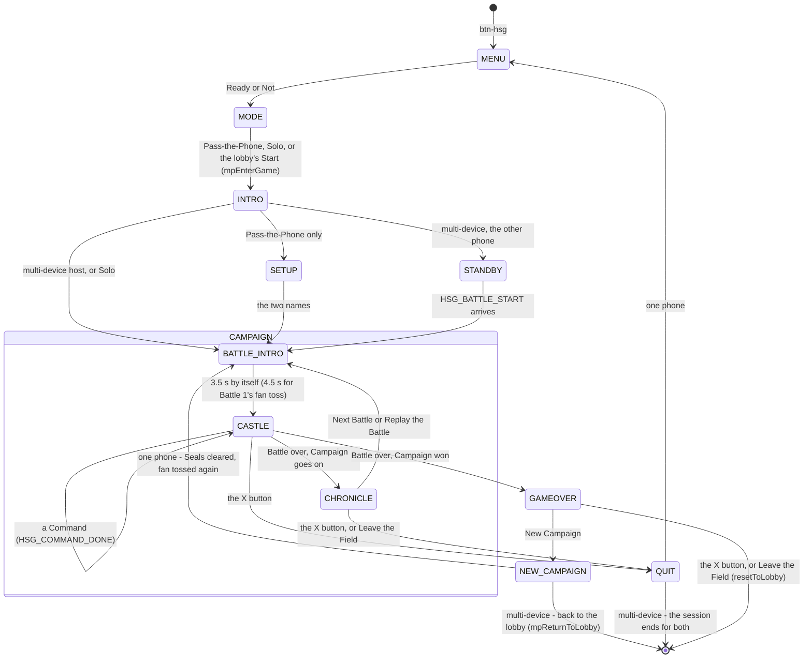

# New Game Technical Spec — Hide and Shogun
**Document type:** Phase 2 — Technical Specification
**Who filled it in:** Claude Code (Opus), 11 Nov 2026, from brief v5 (`docs/new-game-brief-hide-and-shogun.md`, Stage 1b closed the same day)
**Status:** DRAFT — awaiting the owner's confirmation. **No game code until it is confirmed.**

> **Once confirmed, this document is the implementation spec.** Build from it, not from the brief or from
> memory. Where the two disagree, this wins; anything this changes from the brief is in §17.

---

## In plain English — how the game is put together

Think of the **host's phone as the Storyteller holding the secret seating chart.** Only the host
knows who is hiding behind which door. Every phone, the host's included, draws the castle from a
**public copy** of the board that shows opened pieces only; a closed door in that copy is just "a
closed door". When someone opens a door, the host looks at its secret chart, writes the piece into the
public copy, and sends the new public copy to both phones. So a closed door's contents never travel
over the internet and never appear on any screen until it is opened.

There are three parts, each in its own file:

1. **The rules** (`js/games/hsg-rules.js`) — the rules engine and bots that already exist in the idea
   folder, lifted in nearly unchanged. Pure: no screens, no network. That is what lets the same file be
   tested move-for-move against the Python simulation.
2. **The game** (`js/games/hsg.js`) — the Campaign (Seals, who goes first, Truce replays), the public
   copy of the board, the packets between phones, and every screen.
3. **The Storyteller** (`js/games/hsg-scene.js`) — the kneeling figure and his fan, drawn in code, used
   by the Intro and the Battle intro.

The one rule that shapes everything: **the host decides, then tells.** A client phone asks ("I'd like
to open C3"); the host checks it is legal, plays it, and broadcasts the result. Nothing is ever
decided on two phones at once.

---

## Consistency Audit (complete before filling any other section)

| Check | Finding |
|-------|---------|
| Terminology collisions across the 21 games' identity docs (every §9 term grepped) | **No collision of meaning.** Same word, different job, accepted: **"March"** — CLD's button "March On!" (a button label; HSG's is a move name). **"Charge"** — PKO's Stampede confirm button "Charge!" (a button label; HSG's is the Samurai's move). **"Guard"** — COMB's "Guard Bee" / "Fiercest Guard", CJAR's "On Guard" option (compound names; HSG's is a piece). **"Chronicle"** — DYB's "Post-Climb Chronicle" (a log on its gameover; HSG's "War Chronicle" is a result screen — same sense of the word, distinct qualifier, acceptable). **"Door"** — CJAR and ETA use it in prose only. The brief's v5 collision renames (Vault → Leap, Exposed → Unguarded, Long Night → The Last Lantern, Ivory → Indigo) stand. Flip You For It (also in design) uses none of HSG's terms. |
| Brand colour has a `pill-active-*` class in `css/styles.css`? | **No** — `#B8862B` appears nowhere in `css/styles.css`. Lantern gold is not a Tailwind colour, so it takes custom classes like DYB's: `hsg-cta`, `hsg-label`, `pill-active-hsg`, `game-toggle-on-hsg`, `hsg-range`, a light Settings tint and a modal border (values §1). |
| Abbreviation `hsg` conflicts with a plugin prefix? | **No.** Not in `definitions.md`'s active list; already reserved on the brief template's taken line and in the Arcade's reserved list (`js/arcade/arcade-roster.md`). **Added to `definitions.md` as reserved in this pass.** No `hsg`/`Hsg` symbol exists in `js/`, `src/`, `css/`, `sw.js` or `tools/`. |
| Screen ID conflicts in `allScreens[]`? | **No** — no `screen-hsg-*` exists. Seven new IDs (§3). |
| New data file, or reuse `words.json` / `ygi-data.json`? | **Neither** — no word content (brief §10). The piece list is a constant in the rules file. No `data/hsg-*.json`. |
| Reusable engine functions / shared modules | **Reused:** `mpEnterGame` + the Intro (roll call), the bots engine (`mpBotsPrompt`, `mpSeatLabel`, Solo), Client Reconnect, `mpNotifyPlayerLeft`, `mpReturnToLobby`, `mpLockSync`/`mpUnlockSync`, `bindCardHold` + `refHighlightRow` (long-press → gallery row), `assetFace`/`assetBack` (the tile seam), the `play*()` catalogue (§9). **Not used, on purpose:** `showWhoFirst()` (team games only — HSG has no teams; the Storyteller's fan toss is a random pick inside the Battle intro), the pass-gate pattern (nothing is private to one player), `normaliseWord` (no word input), `Cards` / `CanvasDraw` / `Physics` (no cards, drawing or physics). |

**Flags:**
1. **`MP_END_SCREENS` needs a final screen that is *only* final.** A Battle's War Chronicle is a
   per-round result screen (like GM's and NT's, which are left out of `MP_END_SCREENS` on purpose).
   Putting it in would stop reconnect watching after Battle 1. **Resolution:** two screens —
   `screen-hsg-chronicle` (between Battles) and `screen-hsg-gameover` (the Campaign's last War
   Chronicle, in `MP_END_SCREENS`). One render function draws both (§3, §17 #4).
2. **The suite's bots have three levels, not five** (`MP_BOT_DIFFICULTIES = ['easy','medium','hard']`,
   one difficulty per match, picked on the host lobby's pills). §11 maps the prototype's five onto three.
3. **The prototype's parity traces are 14 MB** (`docs/new-ideas/hide and shogun/parity.json`), plus a
   650 KB zip. They should not be committed (§16 Q8).
4. **Three harness pin lists grow** in `tools/verify-mp-configs.js`: reconnect adopters (§ 7), bot
   adopters (§ 8, currently `['cld']`), intro adopters (currently `['li5','eta']`).

---

## §1 — Identity

| Field | Value |
|-------|-------|
| Full name | Hide and Shogun |
| Short ID / abbreviation | `hsg` (`activeGameId = 'hsg'`) |
| Plugin files | `js/games/hsg-rules.js` (rules + bots, pure) · `js/games/hsg-scene.js` (the Storyteller, pure) · `js/games/hsg.js` (the game) |
| Brand colour | **Lantern gold `#B8862B`** — custom classes, not Tailwind |
| Brand classes (proposed — checked with `visual-check` at build) | `hsg-cta`: bg `#B8862B`, hover `#9C6A1E` (Brass), white ink · `hsg-label` (step labels, accent text on off-white): `#9C6A1E` (≈4.7:1) · `pill-active-hsg` / `game-toggle-on-hsg`: `#B8862B` + white · `hsg-range`: `#F4EAD3 → #B8862B` · Settings button tint: `bg-[#F4EAD3] hover:bg-[#ECDDBC] text-[#7A5517]` · modal border: `border-[#DCC08A]` |
| Active pill class | `pill-active-hsg` — **add** to `css/styles.css` |
| Lobby button ID | `#btn-hsg` |
| Play CTA label | **Ready or Not** (placeholder the owner hasn't objected to — §16 Q1) |
| Menu title | Two stacked `<h1>`s: "Hide and" (`text-stone-800`) · "Shogun" (`hsg-label`) |
| Menu tagline | Find their Shogun before they find yours. |
| Directions board | <https://claude.ai/artifact/VV1GPAEBBKY7LnydeRrEuu> — **Mix · The Castle**, **A · Battle intro**, **A · War Chronicle**, **Brand colour · towards the lamplight** |

### Piece ids (stable, packet-safe, skin-safe)

The engine still uses v4 codes. They are renamed at the lift; both test files' `exp_matrix` follow.

| Piece | v5 id | v4 code (engine today) | Rank |
|---|---|---|---|
| Shogun | `Sg` | `Sg` | 8 |
| Guard | `Gd` | `Dm` | 7 |
| Monk | `Mk` | `On` | 6 |
| Samurai | `Sm` | `Sm` | 5 |
| Ninja | `Nj` | `Kn` | 4 |
| Archer | `Ar` | `Gn` | 3 |
| Farmer | `Fm` | `Rn` | 2 |
| Fox | `Fx` | `Gs` | — |

Colours: `0` Indigo Moon · `1` Crimson Sun · `2` a fox nobody has found yet (only ever behind a door).

### §1b — The Intro and the scene

```js
intro: {
  template: 'intro-hsg',            // <template> in src/screens/hsg.html
  // js/games/hsg-scene.js — mount(el, opts) / stop() / beat(i, text). Built (S5): the engine gets
  // hsgIntroScene, a thin wrapper in hsg.js that plays the fan snap when the beats end live.
  scene:    () => (typeof hsgIntroScene !== 'undefined' ? hsgIntroScene : null),
  // one brief for everyone (nothing is secret); the variant only follows The Campaign setting.
  // typeof guard: this object is built before hsg.js loads (and verify-mp-configs runs it bare).
  brief:    () => (typeof hsgCampaignLen === 'undefined' || hsgCampaignLen === 3) ? 'default'
                 : hsgCampaignLen === 1 ? 'single' : 'five',
  // no lineup → the Intro shows a roll call of the two players
},
```

```html
<template id="intro-hsg">
  <p data-intro-narrator>The Storyteller</p>
  <p data-intro-role>A rakugo teller, hired for the night</p>
  <p data-intro-line>Ahem! Tonight, the whole castle plays hide-and-seek.</p>
  <p data-intro-line>Two clans. Thirty doors. Someone behind every one.</p>
  <p data-intro-line>Find their Shogun before they find yours.</p>
  <p data-intro-line>And mind the foxes. They side with whoever finds them.</p>
  <ul data-intro-brief="default">
    <li>Your go: slide open a door, or move one of yours.</li>
    <li>Tap a piece to see where it can go and what it can strike.</li>
    <li>Strike their Shogun to win the Battle. First to 3 Seals.</li>
  </ul>
  <ul data-intro-brief="single"> <!-- same first two lines; third: "Strike their Shogun to win. One Battle decides it." --> </ul>
  <ul data-intro-brief="five">   <!-- same first two lines; third: "…First to 5 Seals." --> </ul>
  <p data-intro-roll>The lords take their cushions.</p>
  <p data-intro-ready-tag>BOWED IN</p>
</template>
```

| Field | Value |
|-------|-------|
| Brief variants | One (`default`). **One wrinkle:** the third line says "First to 3 Seals", which is wrong when the Campaign is set to Single Battle or First to 5. The template is static text, so `brief()` picks between three variants: `default` (First to 3), `single` ("Strike their Shogun to win. One Battle decides it."), `five` ("…First to 5 Seals."). Copy proposal — §16 Q6. |
| Line-up | None — two players, no teams. The engine's roll call (heading "The lords take their cushions.", stamp **BOWED IN**). A bot is pre-ready. Pass-the-Phone is one tap (**Let's go**). |
| Scene | **The Storyteller kneeling on his cushion before a lamplit shoji, fan in hand.** CSS + inline SVG (a sumi-ink figure, one lamp glow, the shoji lattice). `beat(i, text)`: the fan lifts on each line; `beat(-1, '')` = the fan snap. Static tier: lamp glow without flicker, fan held still. Reduced motion: the static tier always. No WebGL. Same module draws the Battle intro's shoji backdrop and fan-toss pose (`mount(el, { mode: 'battle', toss: true })`). The silhouette paths are an art task at build (brief §11). |
| Scene file registration | `hsg-rules.js`, `hsg-scene.js`, `hsg.js` added to `sw.js` `PRECACHE_URLS` + `CACHE_NAME` bump, to `CLAUDE.md`'s load order (after `eta.js`, before `controller.js`, in that order), and to `_scripts-*.html` |
| Round intro / mood beat | **The Battle intro** (`screen-hsg-battle-intro`), every Battle including replays. Flavour line picked at random **by the host** (index carried in `HSG_BATTLE_START`), so both phones show the same one. Lines: brief §0c. |
| Departures needed (log on `docs/ui-revamp-rollout.md`) | (1) The Castle is a fixed-height, non-scrolling board, not a scrolling Stack. (2) Sylly Mode is deferred, so the settings overlay uses COMB's no-Sylly-Mode form for now. Both §17. |

---

## §2 — State Flow



`MODE` is the suite's `screen-mp-mode` (Pass-the-Phone · Host · Join · Solo); `INTRO` is the engine's
`screen-game-intro`. Solo and multi-device both pass through the host lobby (`screen-mp-lobby-host`)
between `MODE` and `INTRO`, where a bot can take the second seat.

**Sub-states within screens:**

| Screen | Sub-states | State variable |
|--------|-----------|----------------|
| `screen-hsg-castle` | `idle` (my Command, nothing picked) · `picked` (a piece lifted, its marks lit) · `door` (a door lifted, "Open?" showing) · `waiting` (the other player's Command, read-only) · `sending` (my Command sent, awaiting the host) · `ending` (the Found you! / last-lantern / Cornered beat, then the War Chronicle) | `hsgUi` — derived each render from `hsgPub.turnSeat`, `hsgSel`, `hsgDoorArmed`, `syllySyncLocked`, `hsgPhase` |
| `screen-hsg-battle-intro` | `toss` (Battle 1: the fan in the air) · `battle` (Battle N) · `replay` (after a Truce — a Truce in Battle 1 replays, it does not toss again) | `hsgBattleIntroText(pub, flavourIdx)` → state, title, flavour, call, `ms` (4.5 s toss / 3.5 s), `snapMs` (1.7 s landing / 0.9 s snap). Pure, so the client (S7) derives the same timing from the same pub |
| `screen-hsg-chronicle` / `-gameover` | five result variants: Found you! · Gekokujo! · The Last Lantern · Truce · Cornered (brief §17) | `hsgPub.result.reason` + `.gekokujo` |

**Host phase** — the host's own bookkeeping, also what `reconnect.sendState` tells a rejoiner:
`hsgPhase: 'idle' | 'battle-intro' | 'castle' | 'ending' | 'chronicle' | 'gameover'`.

**Pass-the-phone gate points:** none. Nothing on any screen is private to one player (brief §12 Q2);
the hidden doors are hidden from both. No `screen-hsg-pass-gate`.

**`showWhoFirst()`:** not used — not a team game. Battle 1's first player is a random pick (the fan
toss); after that the first move alternates every Battle, replays included.

**Screen layout** — the Stack everywhere except the Castle (a logged departure, §17 #7):

| Screen ID | Header | Stage | Controls |
|-----------|--------|-------|----------|
| `screen-hsg-menu` | 🔊 (absolute) | 🏯, the split title, the tagline | Ready or Not · How to Play · Settings · ← Back to the Box |
| `screen-hsg-setup` | "Who's playing?" · 🔊 ✕ | two name inputs ("First lord" / "Second lord" placeholders) | one brand CTA, "Take your cushions" |
| `screen-hsg-standby` | Hide and Shogun · 🔊 ✕ | the lamplit shoji, "The Storyteller is setting out the cushions…" | none |
| `screen-hsg-battle-intro` | none (interstitial: auto-advances, no controls) | lantern beam, title, Seal tally, the Storyteller, the cream card | none — a thin progress bar |
| `screen-hsg-castle` | Battle N · First to 3 · [?] 🔊 ✕ | opponent bar · lantern beam · the 5×6 board · your bar | the message card (it speaks; the board is the control surface) |
| `screen-hsg-chronicle` | THE WAR CHRONICLE · 🔊 ✕ | banners on a beam, headline, sub-line, quote, two stat boxes, Seal tally | Next Battle / Replay the Battle (brand) · Leave the Field (stone), same size |
| `screen-hsg-gameover` | THE WAR CHRONICLE · 🔊 ✕ | the same, headline "Hana takes the Campaign!" | New Campaign (brand) · Leave the Field (stone), same size |

**The Castle's fixed layout** (from "Mix · The Castle", 375×667, top down): header 48 · opponent bar
40 · lantern beam 24 · board (5×6 tiles of 58 px, 3 px gaps, a 7 px lacquer frame with a 2 px
gold-leaf rim) · your bar 40 · message card ~58. In multi-device play **your own bar is always the
bottom one**. In Pass-the-Phone the bottom bar is fixed to the first name entered (the phone lies on
the table; nothing flips). In Solo the human is at the bottom. **Compact layout** below ~520 px of
height: the two bars merge into one strip, the message card shrinks to one line, tiles fall to about
50 px — measured at 320×452, 375×548 and 375×667 with the longest strings before it is settled
(`docs/ui-revamp-lessons.md` L7).

---

## §3 — Screen Registry

| Screen ID | Purpose | TV | Notes |
|-----------|---------|----|-------|
| `screen-hsg-menu` | Game menu | public | Four-button standard, `gel-btn` |
| `screen-hsg-setup` | Pass-the-Phone names | public | Pass-the-Phone only. Multi-device and Solo take names from the lobby |
| `screen-hsg-standby` | Client waiting for the host; a rejoining phone's landing screen | public | `onPassThePhone` on a client lands here; safe to re-run |
| `screen-hsg-battle-intro` | The Battle intro | public | Interstitial: auto-advances, no controls → no chrome (`ui-style.md` § Global UI Protocol 5) |
| `screen-hsg-castle` | The board | public | Every moment (banners, fox, Guard, lanterns, strike, Found you!) plays here, in an absolute layer |
| `screen-hsg-chronicle` | War Chronicle between Battles | public | **Not** in `MP_END_SCREENS` (per-round). ✕ → Leave the Field? (forfeit) |
| `screen-hsg-gameover` | War Chronicle when the Campaign is won | public | **In `MP_END_SCREENS`.** ✕ → `resetToLobby()` directly |

**Total new screens: 7** — all added to `allScreens[]` in `engine.js`. (The Intro is the engine's own
`screen-game-intro`.) **TV public state (hsg):** the whole public board, whose Command, the last
Command, lanterns, Guard rings, fox slots, Seals, the result — i.e. everything in `hsgPub`. Never
`hsgS`.

**Team setup screens:** none (no teams).

---

## §4 — State Variables

```javascript
// ── Settings (persist between play-agains; ride SETTINGS_SYNC) ─────────────
let hsgCampaignLen = 3;        // 1 | 3 | 5 — Seals to win (1 = Single Battle)
let hsgFoxes       = 4;        // 2 (A Pair) | 4 (A Skulk); A Pair gives each clan 4 Farmers

// ── Roster (set at entry; persist across play-agains) ──────────────────────
let hsgNames       = ['', '']; // per seat — Pass-the-Phone setup, or mpSeatLabel(i)

// ── The secret — HOST / ONE-PHONE ONLY. Never sent, never rendered. ─────────
let hsgB           = null;     // HsgRules battle: { S (engine state incl. the layout), team, over, … }

// ── The public copy — every device holds this and only this ────────────────
let hsgPub         = null;     // the snapshot (schema below); the ONLY thing renderers read

// ── Campaign bookkeeping (host / one phone; mirrored into hsgPub) ──────────
let hsgPhase       = 'idle';   // 'idle'|'battle-intro'|'castle'|'ending'|'chronicle'|'gameover'
let hsgBattleNo    = 1;        // a Truce replay keeps the number
let hsgReplay      = false;
let hsgFirstSeat   = 0;        // seat that opens this Battle; flips every Battle, replays included
let hsgSeals       = [0, 0];   // per seat
let hsgStruck      = [0, 0];   // pieces struck per colour, this Battle (War Chronicle stat)

// ── UI state (every device; display only) ──────────────────────────────────
let hsgSel         = -1;       // square of the lifted piece, -1 = none
let hsgDoorArmed   = -1;       // square of the lifted door ("Open?"), -1 = none
let hsgFlavourIdx  = 0;        // Battle intro line (host-picked in multi-device)
let hsgTimers      = [];       // EVERY setTimeout handle this game owns — hsgStopTimers() clears all
```

**`hsgPub` — the public snapshot (also the wire format).** Firebase erases empty values, so nothing in
it is ever `null`, `{}` or `[]`; every collection has a fixed length and is rebuilt on receipt
(`hsgWirePub(p)`, the `cjarWireArr` idea).

```javascript
{
  battleNo: 1, replay: false,
  firstSeat: 0,              // who opened this Battle
  turnSeat: 0,               // whose Command it is
  cmd: 0,                    // Commands made this Battle — the packet tag
  board: [/* 30 strings, A1…E6, index = row*5 + col */],
  seatCol: [-1, -1],         // each seat's clan colour; -1 before the banners (never null)
  guards: [2, 2],            // Guards left per COLOUR, closed ones included — Guarded while > 0
  foxesHeld: [0, 0],         // per seat — the fox slots
  foxTotal: 4,
  quiet: 0,                  // quiet Commands in a row; lanterns lit = 12 - quiet
  struck: [0, 0],            // per colour
  seals: [0, 0], campaignLen: 3,
  last: { k: 'none' },       // or { k: 'U'|'M'|'C'|'S', i, j, kind, seat, vid } — the last Command;
                             //   seat = who made it, vid = the piece struck ('' otherwise) — both
                             //   already in the open; added S4 so the message card can say it
  result: { reason: 'none' } // or { reason: 'shogun'|'lantern'|'truce'|'cornered',
                             //      winnerSeat (-1 = Truce), by (piece id), gekokujo,
                             //      counts: [indigo, crimson], campaignOver }
}
```

**A board cell string:**
- `'.'` — an empty square
- `'#'` — a closed door (nothing else about it, ever)
- `'<id><colour>'` — a piece in the open, e.g. `'Sg1'` = Crimson Shogun, `'Fx0'` = an Indigo fox
- `'Fxp<seat>'` — a fox found **before** the banners, waiting to take that seat's colour

**Seat ↔ engine team.** The engine numbers players by turn order *within a Battle* (team 0 moves
first). The game numbers them by seat. One helper, `hsgSeatOfTeam(t) = (hsgFirstSeat + t) % 2`, is
the only place the two meet; nothing outside `hsg.js`'s host appliers ever sees a team number.

**Derived at runtime (never stored):** Guarded (`guards[col] > 0`) · lanterns lit (`12 - quiet`) ·
closed-door count (`board` cells equal to `'#'`) · the Campaign winner (`seals[s] >= campaignLen`) ·
my seat (`mpMyPlayerIdx` in multi-device; the commander in Pass-the-Phone) · legal Commands on any
device: `HsgRules.legal()` run on `hsgMaskedState(hsgPub)` (below).

**`hsgMaskedState(pub)` — one function, three users.** It rebuilds an engine state from the public
copy, with every closed door as an opaque `[-1, '?', false]`. The engine's legality code never looks
inside a closed cell (checked against `engine.js`: `genActions` only offers an Open there,
`pieceStrikes` tests `faceUp` before reading a target, the Ninja counts a closed door only as a
screen, and the Guard test reads the public Guard count). So the **client** lights its legal moves
from it, the **bot** decides from it (§11), and the **host's own screen** draws from it too — no
renderer anywhere is handed the secret.

---

## §5 — Settings

**Settings overlay title block:** heading **The War Council 🏯** · subtitle *"Set the terms before the
doors slide shut."* (copy proposal — §16 Q6).

| Setting name | Options | Default | Internal variable | Internal values |
|---|---|---|---|---|
| The Campaign | Single Battle · First to 3 · First to 5 | First to 3 | `hsgCampaignLen` | `1` / `3` / `5` |
| The Foxes | A Pair · A Skulk | A Skulk | `hsgFoxes` | `2` / `4` |

**No ✨ Sylly Mode card** while Sylly Mode is deferred (COMB's no-Sylly-Mode form — a dead toggle is
worse than nothing; §17 #6). The How to Play card carries **✨ Sylly Mode · Not yet** · *"The
Storyteller is still writing this one. Coming later."*

| Setting | Description text | Dynamic value line |
|---|---|---|
| The Campaign | How many Battles a lord must win to take the Campaign. | not needed — the labels state the value |
| The Foxes | How many foxes hide behind the doors. Fewer foxes means more Farmers. | **Required:** "2 foxes · 4 Farmers a clan" / "4 foxes · 3 Farmers a clan" |

**Bot difficulty** is not a War Council setting: the suite picks it on the host lobby's Easy / Medium
/ Hard pills, shown only when a bot is seated.

**Multi-device:** settings are chosen on the host's menu before the room exists and ride
`SETTINGS_SYNC` — `mpSerialiseSettings` / `mpApplySettings` gain `case 'hsg': { hsgCampaignLen,
hsgFoxes }`. A client never sees the menu, so the brief's "read-only War Council on the client" needs
no build. Neither setting affects the player range (always 2).

---

## §6 — Scoring Logic

A Command resolves its one action, then the host checks, **in this order** (brief §4d): a Shogun
struck → the Last Lantern → is the next player Cornered? Then it builds the snapshot and sends it once.

| Outcome | `result.reason` | Who scores | Seals | Battle ends? |
|---|---|---|---|---|
| A Shogun is struck | `'shogun'` | the striker's seat | +1 | yes, at once. `gekokujo = (by === 'Fm')` |
| 12 quiet Commands in a row, counts differ | `'lantern'` | the seat whose colour has more pieces in the open (`'Fxp'` and `'#'` count for nobody; a found fox counts for her side) | +1 | yes |
| 12 quiet Commands, counts equal | `'truce'` | nobody | 0 | yes — the Battle is replayed |
| The player to move has no legal Command | `'cornered'` | the other seat | +1 | yes |

- **Quiet** = a March or a Charge. Any Open or Strike, by either player, resets `quiet` to 0.
- **Campaign won** when `seals[s] >= hsgCampaignLen` → `result.campaignOver = true` → every device goes
  to `screen-hsg-gameover` instead of `screen-hsg-chronicle`.
- **Next Battle:** after a Truce, `hsgReplay = true` and `hsgBattleNo` stays; otherwise
  `hsgBattleNo++` and `hsgReplay = false`. **Either way `hsgFirstSeat = 1 - hsgFirstSeat`.**
- **New Campaign:** `hsgSeals = [0,0]`, `hsgBattleNo = 1`, `hsgReplay = false`, `hsgFirstSeat` = a
  fresh fan toss (`Math.random() < 0.5`).
- **A Battle always ends.** Opens are capped at 30 and strikes at 28; the Last Lantern ends any 12
  quiet Commands. So a Battle is at most about 30 + 28 + 12 × 59 ≈ 770 Commands — no extra cap needed
  in play (the engine's `maxCmd` stays for headless runs).
- **Tie-break:** none beyond the Truce. A Truce shows **Replay the Battle**; the Seal tally is
  unchanged.
- **Leaving the Field** ends the session (§11 quit contract). No Seal is recorded — nothing persists.
- **Scoring functions:** `hsgHostCommand(seat, act)` resolves a Command; `hsgEndBattle(result)`
  awards the Seal and decides `campaignOver`. Both host / one-phone only.

---

## §7 — Validation Rules

| Input | Block condition | What happens | Animation |
|---|---|---|---|
| Tap an unlit square | not a legal target for the lifted piece | the piece is put down; no error | none (brief §14: only legal squares light up) |
| Tap the board while waiting | not my Command, or my Command already sent | nothing | none |
| Second tap on a different door | another door was lifted | the first door drops, the new one lifts | the 7 px lift |
| Pass-the-Phone names | both names identical (after `trim`, case-insensitive) | "Two lords can't share a name." under the inputs | `shake` on the second input |
| Pass-the-Phone names | blank | default "Lord 1" / "Lord 2" (proposal — §16 Q6) | none |
| **Host:** an `HSG_COMMAND` | the sender's seat (from `originId`) isn't `turnSeat` · `cmd` ≠ `hsgPub.cmd` · the action isn't in `HsgRules.legal()` · `hsgPhase` isn't `'castle'`/`'battle-intro'` | dropped, and the host privately re-sends `HSG_STATE` to that seat — which also releases its sync lock | none |

**Stemmer / fuzzy match:** not needed (no words).

---

## §8 — Overlay Registry

| Overlay ID | Pattern | z-index | Trigger | Notes |
|---|---|---|---|---|
| `hsg-settings-overlay` | Data (slide-up) | z-[80] | `#btn-hsg-menu-settings` | The War Council 🏯; `scrollTop = 0` on open |
| `hsg-how-to-overlay` | Data (slide-up) | z-[90] | `#btn-hsg-menu-how-to`, `#btn-hsg-how-to` (Castle header), a long-press on any piece | Tabs **Rules · Practice · The Household** |
| `hsg-quit-overlay` | Decision modal | z-[80] | `.btn-hsg-quit-open` (Castle ✕, Chronicle ✕, Chronicle's Leave the Field) | Mid-Campaign only |
| `hsg-new-campaign-overlay` | Decision modal | z-[90] | `#btn-hsg-go-new` on `screen-hsg-gameover` | Required — never resets directly |

No tip overlay: the game has no contextual `[?]` points — the message card names the lifted piece and
its options, and a long-press opens its gallery row.

**Quit overlay copy** (brief §9):
- Emoji 🏯 · Heading **Leave the Field?** · Subtext *"Slip away now and the whole Campaign goes to your
  opponent."* · Confirm **Yeah, slip away** (`bg-red-500`, destructive) · Cancel **Not yet!**

**New Campaign overlay copy** (the brief names the box but not its words — proposal, §16 Q6):
- Emoji 🏮 · Heading **New Campaign?** · Subtext *"Every Seal comes off and the fan is tossed again."*
- Confirm (set when opened): one phone **Toss the fan** · host **Restart in the lobby** · client
  **Leave Session** — no emoji on action labels · Cancel **Stay here**

Inner class strings verbatim from the template; decision modals take `border border-[#DCC08A]`.

---

## §9 — Audio Map

**Two new `play*()` functions (owner, 11 Nov 2026)** — the world's two signature sounds, which
nothing in the catalogue resembles. Both synthesised in `engine.js` like every other effect (no files),
both catalogued in `docs/rules/audio.md` in the same pass, both guarded by `isMuted || !sfxEnabled`:

| New function | Semantic meaning | Sound |
|---|---|---|
| `playPaperSlide()` | HSG: a paper door slides open | Band-passed noise (~1.2–2.5 kHz) with a soft attack and a slight downward filter sweep, ~180 ms — the hiss of paper on a wooden runner |
| `playFanSnap()` | HSG: a folding fan snapped shut — a strike, and the Storyteller's punctuation | A sharp high-passed noise click (~25 ms) over a short triangle "clack" (~300 Hz falling), ~70 ms total |

Everything else is one map, `HSG_SOUND` in `hsg.js`, pointing each moment at a sound (the CJAR / COMB
pattern):

| Moment (brief §16) | `HSG_SOUND` key | Function | Notes |
|---|---|---|---|
| Menu Play CTA, Next Battle | — | `playLaunch()` | |
| A door slides open | `open` | **`playPaperSlide()`** | |
| …and it's a Shogun | `openShogun` | `playPaperSlide()` + `playHullThud()` | the "small taiko tap" |
| March / Charge | `march` | `playPillClick()` | a light wooden clack |
| Strike (up close, diagonal) | `strike` | **`playFanSnap()`** + `playWhoosh()` | fan snap, then the ink-splash swish |
| Volley · Leap | `volley` · `leap` | `playWhoosh()` | |
| A fox is found | `fox` | `playSuccess()` | the yip-chime |
| The Guard falls | `guardFall` | `playBoing()` | |
| A lantern goes out | — | silent | the brief: lanterns are visual only, never ticking |
| Found you! / Gekokujo! | `foundYou` | **`playFanSnap()`** + `playClashWin()` | the big snap, then the deep finish |
| The Storyteller's fan snap (the Intro's last beat) | `fan` | **`playFanSnap()`** | `HsgScene` stays pure: the game calls it from the `beat(-1)` path |
| The last lantern goes out (win) | `lantern` | `playUnchallenged()` | |
| Truce | `truce` | `playDone()` | |
| Cornered | `cornered` | `playBoing()` | |
| Settings pill | — | `playPillClick()` | |
| Close overlay | — | `playDone()` | |
| Quit / leave confirm | — | `playExit()` | |

**Music:** a koto/shamisen track is content, not code — a `data/music/` file plus a manifest line,
runtime-cached; until one exists the lobby fallback plays. Never war drums, never ticking.

---

## §10 — Word Bank & Data

**Source:** none — no word content (brief §10). No data file, no `sw.js` data entry.

**Secret Mode / expansion packs:** none in v1 — no word pool, so no `hsgApplyExpansionOverrides()`.
(The new-game checklist's word-pool and difficulty-tier items don't apply.)

**Custom assets (asset-pack readiness)** — the piece tile is the repeated primitive.

| Field | Value |
|-------|-------|
| Visual primitive | The piece tile and the closed door |
| Render-seam function | `hsgRenderTile(cell, opts)` → DOM node. `cell` is a board string (`'Sg1'`, `'#'`, `'.'`, `'Fxp0'`); `opts`: `{ size, marks, picked, armed, last, gallery }` |
| Id key | the piece id + colour, e.g. `Sg1`; the door is `door` |
| Asset `kind` | `hsg` |
| Default v1 look | Drawn in code: a sumi-ink shadow-puppet silhouette (inline SVG path per piece) in the lamplight, a clan-colour sash with the printed name, a 14 px crest disc (sun / crescent / paw), rank pips. The door: lamplit cream paper with lacquer kumiko lines. |

Seam contract: at the top of `hsgRenderTile`, `const url = (typeof assetFace === 'function') &&
assetFace('hsg', id);` → if there is a url, an image node; else the default face. A closed door reads
`assetBack('hsg')`. **The board, the How to Play gallery and the Practice lessons all draw tiles
through this one function** — nothing else builds a tile.

---

## §11 — Multiplayer Configuration

| Field | Value |
|-------|-------|
| Modes | `supportedModes: ['ptp', 'mdlm', 'solo']`, `recommendedMode: 'mdlm'`, `multiplayerOnly: false`. No Team Lobby (two individuals) |
| Seating | `rosterConfig: { type: 'none' }` |
| Bounds | `getMinPlayers: () => 2`, `getMaxPlayers: () => 2` — bare constants |
| New MP screens | none — the shared mode / lobby / Intro screens |
| Entry | every route through `mpEnterGame(cfg)`; `onPassThePhone: () => hsgOnEnter()` — host → `hsgStartCampaign()`; client → `screen-hsg-standby` (safe to re-run on a rejoin); one phone → `screen-hsg-setup` |
| End screen | `'screen-hsg-gameover'` added to `MP_END_SCREENS` (only that one — Flag 1) |
| `MP_PROTOCOL_VERSION` | unchanged — new packets for a new game change no existing packet (ETA precedent) |

**Packets.** Two client actions, three host messages. Every host message carries the **whole**
`hsgPub` — a dropped packet heals on the next one, and a snapshot is built only after the whole
Command has settled (Seal awarded, next-player Cornered check done).

| Packet | Dir | Payload | When |
|---|---|---|---|
| `HSG_COMMAND` | client → host (ACTION) | `{ cmd, act }` — `act` is the engine's action array, e.g. `['U', 7]`, `['S', 3, 13, 'v']` | the client makes a Command (`mpLockSync()` first) |
| `HSG_NEXT_BATTLE` | client → host (ACTION) | `{ battleNo, replay }` — the tag | the client taps Next Battle / Replay the Battle |
| `HSG_BATTLE_START` | host → all (SYNC) | `{ pub, flavourIdx }` | each Battle, replays included |
| `HSG_COMMAND_DONE` | host → all (SYNC) | `{ pub, act, fx }` — `fx`: moment keys (`'banners'`, `'fox:<seat>:<capped>'`, `'guardFall:<col>'`); read as `p.fx \|\| []` | after every Command, the host's, the client's or a bot's |
| `HSG_STATE` | host → one seat (private) | `{ pub, phase }` | `reconnect.sendState(idx)`, and as the repair after a refused `HSG_COMMAND` **or `HSG_NEXT_BATTLE`** (S7). `phase` is `'gameover'` for the ending beat of a Battle that won the Campaign (BUG-02) |

**What the client never receives:** the layout, the engine state, the RNG seed, the unseen-piece
counts. The layout is shuffled on the host from a local seed that never leaves it. *(A seeded deal is
a privacy decision — `logic-engine.md`. HSG sends no seed at all.)*

**The host's own residual.** The host phone holds the layout in memory (`hsgB`). Accepted — couch
security, brief appendix. It never reaches the host's DOM: the host draws from `hsgPub` like everyone
else.

**Per-phase intercept points (the missing-handler audit).** For each phase: *can the non-host device
submit something here?*

| Phase | One phone | Multi-device | Client submits? |
|---|---|---|---|
| The Intro | engine | engine (its four packets) | engine-handled |
| Setup | names → `hsgStartCampaign()` | skipped — names from the lobby | — |
| Standby | — | waits for `HSG_BATTLE_START` | no |
| Battle intro | local timer → Castle | each device's own timer; nothing sent | no |
| Castle: my Command | `hsgHostCommand(seat, act)` | host: `hsgHostCommand` + `HSG_COMMAND_DONE`; client: `HSG_COMMAND` | **yes → `HSG_COMMAND`** |
| Castle: waiting | read-only | read-only; long-press + How to Play are local | no |
| Castle: the ending beat | local timer → Chronicle / Gameover | each device's own timer off the result snapshot | no |
| Chronicle: Next Battle / Replay | `hsgStartBattle()` | **either player**: host directly; client `HSG_NEXT_BATTLE` (§17 #8). The first tap wins; the tag stops a double start | **yes → `HSG_NEXT_BATTLE`** |
| Chronicle / Castle: ✕, Leave the Field | quit overlay → game menu | `mpNotifyPlayerLeft(); resetToLobby();` — the generic contract, no per-game packet | engine-handled |
| Gameover: New Campaign | overlay → new Campaign | host `mpReturnToLobby()`; client leaves | engine-handled |
| Gameover: ✕, Leave the Field | `resetToLobby()` | `resetToLobby()` (a client's seat is released, not Away) | engine-handled |
| How to Play / Practice | local | local — Practice never touches the wire | no |

**Every host applier takes an explicit seat** (`hsgHostCommand(seat, act)`, `hsgHostNextBattle(seat)`)
and skips every broadcast in `'single'` mode — that is what lets one harness play both seats.

**The host's own Command never goes through an ACTION** (the dedup guard drops self-sent ACTIONs):
it applies directly, then broadcasts.

**Applying a snapshot (every device, `hsgApplyPub(pub, act, fx)`):** idempotent, and the snapshot
always wins — a new one cancels any animation still playing and draws the final position. It
releases the sync lock and re-derives `hsgUi`.
*As built (S7):* three client appliers, one per packet (`hsgApplyBattleStart` / `hsgApplyCommandDone`
/ `hsgApplyState`), each releasing the lock first. "Wins" means *newer*: the public and private
channels are not ordered against each other, so a snapshot of the same Battle (same `battleNo`,
`replay` and `firstSeat`) with fewer Commands — or the same Command once the result is held — is ignored, and so
is an `HSG_BATTLE_START` for a Battle already on screen (impl notes ML-01).

**Waiting for the host's answer.** After a client's second tap on a door it starts the 150 ms shadow
flicker at once, and the slide plays when `HSG_COMMAND_DONE` lands — the flicker covers the round
trip. If nothing arrives, the engine's 8 s lock timeout releases the board.

### Bots

```js
bots: {
  names:     ['Sylvia', 'Sam', 'The Lamplighter', 'The Gardener', 'The Cook', 'The Night Watch', 'The Tea Master'],
  pillClass: 'pill-active-hsg',
  view:      i => hsgBotView(i),
  decide:    (v, d, rng) => hsgBotDecide(v, d, rng),
  submit:    (i, move, tag) => hsgBotSubmit(i, move, tag),
  thinkMs:   (d, rng) => hsgBotThinkMs(d, rng),
},
```

| Suite level | Prototype bot | What it does |
|---|---|---|
| Easy | `easy` | random legal Commands, but always takes a Shogun strike |
| Medium (default) | `cautious` | avoids handing over strikes |
| Hard | `search3` | the hunter (steers toward the enemy Shogun, fishes with the Archer and Monk), plus a three-Command look-ahead once every door is open |

The prototype's `aggro` (Hard) and `hunt` (Expert) are dropped (§16 Q3, §17 #2). Head-to-head
strength between the three is untested; the bots harness *reports* it (not an assertion).

- **The view** (`hsgBotView(i)`): the public snapshot, plus the **unseen counts** — how many of each
  piece are still behind doors, which anyone who has watched every door open could work out. Never a
  door's contents. `hsgBotDecide` builds `hsgMaskedState` from it and calls `HsgRules.choose()` with
  an adapter over the suite's `rng` (`random`, `choice`, `shuffle`, `sample`). The engine only reads
  a closed cell's contents in `evaluate()`, which runs only once no doors are left, and in
  `shogunDown()`, which belongs to the cut Shogun's Shame and is removed at the lift.
- **When:** one function, `hsgOpenCommand()`, is the single place a Command opens on the host. If the
  seat to move is a bot it calls `mpBotsPrompt(hsgPub.cmd, [seat])`. It runs when the host's Battle
  intro ends and after every Command that doesn't end the Battle.
- **A simplification worth knowing:** a two-seat game with a bot has no client — the bot's opponent
  is always the host's player. So no client Command ever races a bot's.
- **Submit:** `hsgBotSubmit(i, move, tag)` drops a stale tag (`tag !== hsgPub.cmd`), then calls
  `hsgHostCommand(i, move)` — the same record path as the host's own taps.
- **Think time:** Easy 700–1,200 ms, Medium 900–1,600, Hard 1,100–2,000 — long enough to follow, and
  longer than a strike's animation. Hard's look-ahead runs inside `decide`; the harness times it (§15).

### Reconnect — adopt

`reconnect: { sendState: idx => hsgSendState(idx), pause: () => {}, resume: () => {} }`

- **Why it's cheap:** the whole state is one small public snapshot, the same for both seats (nothing
  is private to a seat, so there is nothing to strip), and the game has **no clock** — nothing auto-
  plays for a seat, so pause and resume have nothing to stop. (The bots' timers are paused by the
  engine itself.)
- `hsgSendState(idx)` → `mpSendPrivate(uid, HSG_STATE { pub, phase })`; `phase` is `'castle'` (a
  rejoiner mid-Battle-intro skips the intro), `'chronicle'` (also for `'ending'`) or `'gameover'`.
- The `HSG_STATE` applier takes standby → live: applies the snapshot and shows the right screen. It
  re-arms nothing, because nothing in HSG is phase-scoped.
- `hsg` joins the adopters pinned in `verify-mp-configs.js` § 7.

**Settings override in Lobby Mode:** none.
**readyCheck matrix:** none — no simultaneous moments.

---

## §12 — Sylly Mode Technical Spec

**None** in v1 (brief §8: deferred). No `hsgSyllyMode` variable. The How to Play card reads
**✨ Sylly Mode · Not yet**; the settings overlay carries no Sylly Mode card (§17 #6).

---

## §13 — `resetToLobby()` Additions

```javascript
// Hide and Shogun teardown
['hsg-settings-overlay', 'hsg-how-to-overlay', 'hsg-quit-overlay', 'hsg-new-campaign-overlay']
  .forEach(id => { const el = document.getElementById(id); if (el) el.style.display = 'none'; });
if (typeof hsgTeardown === 'function') hsgTeardown();
// hsgTeardown(): hsgStopTimers() (the Battle intro, the ending beat, every moment);
// HsgScene.stop(); hsgB = null; hsgPub = null; hsgPhase = 'idle'; hsgSel = -1;
// hsgDoorArmed = -1; hsgSeals = [0,0]; hsgBattleNo = 1; hsgReplay = false;
// hsgStruck = [0,0]. Settings (hsgCampaignLen, hsgFoxes) persist.
```

`hsgStopTimers()` is also called from the quit-confirm handler and at every Battle start. The bots'
timers are the engine's (`mpBotTimers`, cleared by `mpEndMatchLocal()` / `resetToLobby()`). The
lantern flicker is a CSS loop — no handle.

---

## §14 — `src/screens/hsg.html` Section Header

```html
<!-- ════ HIDE AND SHOGUN ════
     Screens : screen-hsg-menu, screen-hsg-setup, screen-hsg-standby, screen-hsg-battle-intro,
               screen-hsg-castle, screen-hsg-chronicle, screen-hsg-gameover
     Overlays: hsg-settings-overlay, hsg-how-to-overlay, hsg-quit-overlay, hsg-new-campaign-overlay
     Template: intro-hsg
  ════════════════════════════════════════════════════════════════ -->
```

Markup lives in `src/screens/hsg.html`; `index.html` is rebuilt by `node tools/build-index.js`.

---

## §15 — Stages and Verification

**Binding at build:** `docs/rules/new-game-checklist.md` (every item), `docs/ui-revamp-lessons.md`
(read at the start, add at the end), the board line by line (L8). One stage per session is the
expected pace; each ends green before the next starts.

### Verification, named up front

**New harnesses** (rules, packets and state only — no presentation assertions):

| Harness | What it proves |
|---|---|
| `tools/verify-hsg-rules.js` | Loads `js/games/hsg-rules.js` in a `vm`. Ports every scenario in `proto/engine_tests.js` with the v5 ids (Sample A, C1–C8, the strike matrix, a closed Guard still guards, the fox share, a fox found before the banners, the Last Lantern counting the open only, Cornered, Truce). **Parity:** replays the Python traces move by move against the shipped file when `HSG_PARITY=<path>` points at `parity.json` (skipped, and says so, when absent). |
| `tools/verify-hsg.js` | The game in `vm`, `'single'` mode, `getElementById → null`, `setTimeout` captured and never fired, `mpSendEnvelope` / `mpSendPrivate` **throwing**. Campaign: first to 1 / 3 / 5; a Truce keeps the Battle number and flips the first move; the first move alternates every Battle. Appliers with an explicit seat play both seats. The codec round-trips. **Privacy:** shuffling the closed doors' contents leaves `hsgPub` byte-identical, and no `'#'` cell ever carries more than `'#'`. A wrong seat, a stale `cmd` and an illegal action are each refused. The Battle-intro and ending timers are *scheduled*. |
| `tools/verify-hsg-loopback.js` | Host + client in two `vm`s, a Firebase-like wire between them (empty values erased), a DOM of real mock elements, a console whose `warn` counts as an error. A full Battle with both seats acting; the client never holds a closed door's contents (same shuffle test, client side); Next Battle from the client; double-tap → one Command; a refused Command repaired by `HSG_STATE`; the quit contract both ways; a drop + rejoin lands on the right screen with the right board. Takes `HSG_SRC=` so a broken copy proves it fails first. |
| `tools/verify-hsg-bots.js` | **Fairness:** shuffled closed-door contents → byte-identical view *and* decision, at all three levels. Every bot Command is legal; bot-vs-bot Battles end. Times Hard's `decide` (budget: under 150 ms on Node, re-checked on the iPhone SE). Reports the level ladder (not asserted). |

**Existing harnesses to re-run:** `verify-mp-configs` (schema, bounds, quit contract, and the three
pin lists: reconnect, bots, intro) · `verify-mp-reconnect` · `verify-game-intro` (+ mutate) ·
`verify-tv-labels` · `verify-build-fresh` · `verify-identity-docs` · `visual-lobby` (the lobby
registries) · `node "docs/new-ideas/hide and shogun/proto/engine_tests.js"` stays as the reference.

**Layout:** the `visual-check` skill at 320×452 → 375×548 → 375×667 for the Castle, the Battle intro
and both War Chronicles, with the longest names, plus a reduced-motion pass.

**Owner hardware:** a two-phone Campaign (MDLM), a Solo Campaign against each level on the iPhone SE
(`?fps` noted), and a Pass-the-Phone Battle. Not replaceable by any harness.

### Stages

- **S1 — The rules lift.** `js/games/hsg-rules.js` from `proto/engine.js`: v5 ids and names, Shogun's
  Shame removed (the idea-folder engine keeps it for comparison runs), the global `HsgRules`, every
  config flag the parity traces need kept. `verify-hsg-rules.js` green, parity included. *No UI.*
- **S2 — The game's state machine, headless.** `hsg.js`: Campaign, `hsgHostCommand`, `hsgEndBattle`,
  the codec and `hsgMaskedState`, `hsgOpenCommand`. `verify-hsg.js` green. *No UI.*
- **S3 — Registration and shells.** `allScreens[]`, `resetToLobby()`, CSS classes, `engine.js` theme
  maps (`updateSliderTheme`, `getMuteToggleOnClass`), `GAME_BRAND_HEX`, the lobby registries
  (`_shell.html` button with the badge shape, `lobby-games.js`, `tv.js` `TV_ORDER`, `LB_NO_STICKER`
  until the sticker exists, `tools/data/games.raw.json` via `build-games.js`), grep for the literal
  suite size (21 → 22), `MP_GAME_CONFIGS.hsg`, `sw.js` + load order. The menu, the War Council, the
  How to Play shell (Rules tab copy). Lobby → menu → settings works.
- **S4 — The Castle, one phone.** `hsgRenderTile` (the seam), the board, the bars, the lantern beam,
  the message card, tap-tap, the two-tap door, drag, the last-move outline. A Pass-the-Phone Battle
  is playable start to finish (plain transitions; the moments come in S9).
- **S5 — The Intro and the Battle intro.** `intro-hsg`, `hsg-scene.js`, the Battle intro with its
  three states. `verify-game-intro` green.
- **S6 — The War Chronicle and the Campaign loop.** Both end screens, five result variants, Next
  Battle / Replay / New Campaign, the two decision modals. A whole Pass-the-Phone Campaign.
- **S7 — Multi-device.** The five packets, the client path, standby, the quit contract.
  `verify-hsg-loopback.js` green; `verify-mp-configs` green.
- **S8 — Bots and Solo.** The `bots` entry, view / decide / submit, the think times. `verify-hsg-
  bots.js` green; a Solo Campaign in the browser.
- **S9 — Reconnect, then the moments.** The `reconnect` hook + loopback rejoin cases. Then Raising the
  Banners, the fox, the Guard ring cracking, the lanterns, the strike, Found you!, the door slide —
  every one in the Castle's absolute layer, each with a static reduced-motion form — and `HSG_SOUND`,
  with `playPaperSlide()` and `playFanSnap()` added to `engine.js` and `docs/rules/audio.md`.
- **S10 — The Household.** The gallery tab: one row per piece through `hsgRenderTile`, the ladder,
  the upsets, the loop triangle; long-press → row (`bindCardHold` + `refHighlightRow`).
- **S11 — Practice.** Nine lessons (brief §24), each a small fixed board on the real rules and the
  real renderers; COMB is the reference (`docs/practice-rollout.md`).
- **S12 — Polish and measure.** The compact layout, `visual-check` at the three sizes, `/impeccable`
  critique → audit → polish, departures logged on the tracker.
- **S13 — Closure.** The identity doc (`docs/game-identities/hsg.md`, T1–T10, `verify-identity-docs`
  green), `code-map.md` (with the TV public-state line), `per-game-classes.md` Tables A–C,
  `definitions.md` (reserved → active), `new-game-brief-template.md` roster from shipped reality,
  implementation notes, SW bump, the phase snapshot.

---

## §16 — Clarifications Required Before Implementation

All non-blockers. Each has a default the spec already uses; answering changes only that line.

| # | Question | Section | Default if unanswered |
|---|---|---|---|
| 1 | Play CTA **Ready or Not**, ready stamp **BOWED IN** — keep? | §1, §1b | Keep both |
| 2 | Reconnect — adopt (a dropped phone can come back mid-Campaign)? | §11 | **Answered 11 Nov 2026: yes, adopt** |
| 3 | Bot levels: the suite has three. Hard = the prototype's strongest (`search3`, the hunter with a look-ahead)? | §11 | **Answered: yes** — Easy = `easy`, Medium = `cautious`, Hard = `search3` |
| 4 | Bot names: Sylvia, Sam, The Lamplighter, The Gardener, The Cook, The Night Watch, The Tea Master? | §11 | That list |
| 5 | Sound: reuse the existing sounds only, or add two new synthesised ones (a paper slide, a fan snap)? | §9 | **Answered: add the two** — `playPaperSlide()`, `playFanSnap()` |
| 6 | Copy the brief doesn't give: the War Council subtitle, the New Campaign? box, the Pass-the-Phone default names, the Intro brief's Single Battle / First to 5 variants | §1b, §5, §7, §8 | The proposals in those sections |
| 7 | The 320×452 compact layout | §2 | The brief's plan (merged bars, one-line card, ~50 px tiles), measured at S12 |
| 8 | Committing: the brief, the decision-log line, the template row and the idea folder — but **not** `parity.json` (14 MB) or `hsg-package-v4.zip` (650 KB)? | — | **Answered: yes** — both git-ignored; the parity harness reads `parity.json` only when pointed at it |

---

## §17 — Deviations from the Phase 1 Brief

| # | Brief said | Spec does instead | Reason |
|---|---|---|---|
| 1 | Lift the engine into `js/games/hsg.js` as global functions | Its own pure file, `js/games/hsg-rules.js`, exposing one global `HsgRules` | It stays loadable in Node, unchanged, for the parity check against the Python sim; same shape as `dyb-dice.js` and `cld-art.js` |
| 2 | Five bot levels (Easy, Normal, Hard, Expert, Expert+) | Three: Easy, **Medium**, Hard (Hard = Expert+) | The suite's bot system has exactly three, shown as Easy / Medium / Hard on the host lobby |
| 3 | A Setup screen for Solo (your name and the bot's skill) | Solo uses the suite's host lobby (name, bot, difficulty); Setup is Pass-the-Phone only | Solo is the suite's own flow; a second setup would duplicate it |
| 4 | One War Chronicle screen | Two: `screen-hsg-chronicle` (between Battles) and `screen-hsg-gameover` (Campaign won), one render function | Reconnect needs a screen that is only ever final; and the ✕ means different things (forfeit vs leave) |
| 5 | A forfeit variant: "Priya left the field. Hana takes the Campaign." | Cut. The other player sees the suite's standard "session ended" message | The suite's quit contract ends the session on both phones at once, and a new per-game quit packet is discouraged (`logic-engine.md`) |
| 6 | Settings list "✨ Sylly Mode — Deferred" | No Sylly Mode card in the War Council; How to Play keeps "✨ Sylly Mode · Not yet" | A toggle that does nothing is worse than no toggle (COMB's form). COMB's is a permanent exception; this one lasts until Sylly Mode is designed — logged as a departure |
| 7 | (brief §19) The Castle is fixed-height | Confirmed and logged on the revamp tracker | The board must never scroll |
| 8 | (silent) who starts the next Battle | Either player can tap Next Battle; the first tap starts it for both | In a one-on-one, making one player wait for the other's button feels lopsided |
| 9 | Sounds per moment (brief §16) | Two new sounds (paper slide, fan snap); the rest mapped onto existing ones; a lantern going out is silent | Owner's call (§16 Q5); the brief also says the lanterns never tick |
| 10 | Waiting player "can long-press any piece" | Long-press works; an ordinary tap does nothing while waiting | Consistent with the brief: the waiting board is read-only |
| 11 | (appendix) remove or keep the Shame code | Removed from the shipped file; kept in the idea-folder engine | Dead code in a shipped file is a trap; the comparison runs still have it |
